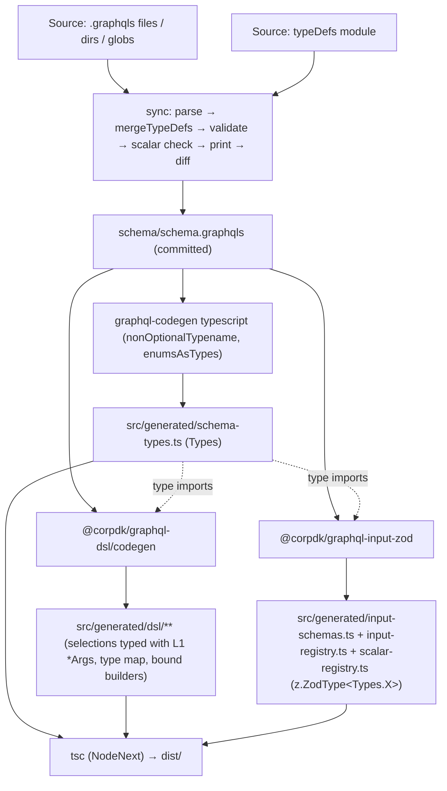

# GraphQL client SDK generator (`@corpdk/create-graphql-sdk`)

Design specification for a **publishable GraphQL client SDK** produced from a **complete schema** (one or many SDL files, or a TypeScript `typeDefs` module), and for the **CLI** that scaffolds, regenerates, and upgrades it. This initiative covers the SDK package, the CLI, and two in-house libraries the SDK is built from. It does not cover the GraphQL server, the automation CLI ([14-graphql-cli-generator.md](14-graphql-cli-generator.md)), or HTTP transport. Apollo, urql, `graphql-sse`, and similar clients stay in consumer apps.

**Status:** Design (pre-implementation). Revision 11. Open work is tracked in the §17 register.

- Appendix A: gap review of revision 1.
- Appendix B: dependency maintenance audit.
- Appendix C: prototype evidence.

**Revision history**

| Rev | Date | Change |
| --- | ---- | ------ |
| 1 | 2026-11-07 | Initial proposal (`buildgql` builder, codegen validation plugin) |
| 2 | 2026-11-08 | Gap review (Appendix A) |
| 3 | 2026-11-12 | Multi-file SDL merge (§4); dependency audit; `gql.tada` replaced `buildgql` |
| 4 | 2026-11-12 | Builder DSL is a hard requirement; `genql` (vendored output) replaced `gql.tada` |
| 5 | 2026-11-12 | **`genql` forked into the owned `@corpdk/graphql-dsl`**, which adds aliases, `@include`/`@skip`, named variables, and native ESM. The DSL computes its result types from the SDK's own `Types.*` (L1) instead of generating a second set of interfaces. |
| 6 | 2026-11-12 | **`templates/ds-sdk` is a test proof and sample, never published** (§9.1). New libraries join the npmjs publish pipeline (§13). All remaining work is collected in the §17 register. Later on rev 6: `graphql-dsl` stays in this monorepo with its own version line and move-out triggers (§16.2.1). The §5 diagram's `z.ZodType<Types.X>` label is escaped (Mermaid stripped it as HTML). |
| 7 | 2026-11-12 | **Shared runtime over copied code:** parse helpers move into `@corpdk/graphql-input-zod` (runtime entry `.`; emitter at `./codegen`), and each SDK's `src/validation.ts` becomes a binding. **Scalar validators:** generated `scalarZodSchemas` registry + `safeParseGraphqlScalar`, used by input fields and by the CLI for top-level scalar arguments. Register items R-32, R-33. |
| 8 | 2026-11-13 | **Final cross-design review** (SDK, CLI, DS generator). Emitter built-in scalars made configurable with spec defaults (DAL overrides keep `dal-codegen` byte-identical; no `@corpdk/dal-core` in SDKs); `scalarReferences` option; `scalarWireFormats`; `validation.enabled: false` defined; optional peers on `graphql-input-zod`. Phase order fixed: the `../ds-sdk` target is removed in P2 with the `templates/ds-sdk` replacement. P1a now updates fixed-order CI/Docker builds; publish bootstrap and trusted-publisher setup recorded; `graphql-dsl` version gate. Script renamed `sdk:codegen`; `init --defer-sync`, `runInit` export, `--schema` path rule. `create-ds` changes moved to [doc 15](15-create-ds-generator-integration.md); `create-app` declared frozen and out of scope (R-22 dropped). Engine built on the shared `@corpdk/engine-kit` with the `create-ds`-style contract (doc 15 §11). Register R-34 to R-36; evidence wording corrected. |
| 9 | 2026-11-13 | **Second cross-design review.** P3 and P4 merged into P2: the DS Docker steps and the `create-graphql-sdk` publish move to P2, because the DS image breaks and `create-ds` would point users at an unpublished engine otherwise. Two `create-app` Dockerfile rows dropped. R-17 folded into doc 15 R-D02; R-24 rescoped. `graphql-dsl` codegen API and its types-only dependency specified; `GraphqlInputIssue.code` source stated. |
| 11 | 2026-11-13 | **Response helpers** (§3.8), adopted after comparing Linear's SDK: a typed request-error normaliser and a Relay connection paginator, both transport-free, in the `graphql-dsl` runtime. **Package bootstrap phase B0** (doc 15 §4.4): every new package is created as a placeholder, published by hand once, and given npm trusted publishing before any implementation phase starts; the per-phase bootstrap steps are removed. R-39 to R-41. |
| 10 | 2026-11-13 | **`@corpdk/scalar-zod`** (§7.7): one package for all scalar rules, extracted from `dal-core`, with Postgres-bounded rules under `/pg`. The DAL preset and built-in overrides reference it instead of copying rules; `dal-core` re-exports. R-37, R-38. |

**Related:** [02-graphql-schema.md](02-graphql-schema.md) · [11-ds-subscription-sse.md](11-ds-subscription-sse.md) · [ds-automation-upgrades.md](ds-automation-upgrades.md) (pattern reference for `create-ds`) · [dal-pg-type-mapping.md](dal-pg-type-mapping.md) · [02-monorepo-design.md](../architecture/02-monorepo-design.md)

---

## 1. Goals and non-goals

| Goals | Non-goals |
| ----- | --------- |
| Generate a publishable SDK from **any** complete GraphQL schema | DS server, resolvers, DAL, databases |
| Accept the schema as **many `.graphql` / `.graphqls` files**, a **TypeScript `typeDefs`** module, or both, merged into **one** SDL (§4) | `typescript-resolvers`, `client-preset`, `@corpdk/codegen-cli` / `ds-cli` output |
| Ship a **typed builder DSL** (DGS-projection style) with aliases, `@include`/`@skip`, named variables, unions/interfaces, and compile-time rejection of unknown fields and arguments (§3.4) | Hand-written GraphQL strings as the primary API |
| **One set of type interfaces:** L1 `Types.*` is what the DSL's arguments and results are typed against, what L3 validators are annotated with, and what consumers import (§3.3) | Two parallel type sets (DSL-private interfaces next to L1) |
| Ship **L3 input validators** (`inputZodSchemas` + parse helpers) | Copying the server's column-aware `input-zod.ts` into the SDK (§7.5) |
| Install the SDK in **Node services** (NodeNext ESM) and **Next.js** apps from the same `dist/` | Transport in the SDK; WebSocket subscriptions (`graphql-ws` is sunset) |
| Shape the CLI like **`@corpdk/create-ds`** (`init`, `upgrade`, regenerate) | Coupling the generator to a CorpDK DS implementation |
| Detect schema drift and breaking changes in CI | Persisted queries, operation allow-lists, Relay artifacts |
| Depend only on packages that pass §16.1, or on code we own (§16.2) | |

---

## 2. Terminology

| Term | Meaning |
| ---- | ------- |
| **Source** | One schema input listed in `sdk.config.yaml`: a file, a directory, a glob, or a `typeDefs` module |
| **Snapshot** | The single merged, validated, sorted SDL file committed at `schema/schema.graphqls` |
| **L1 types** | TypeScript interfaces for every schema type, from `@graphql-codegen/typescript`. The SDK's only entity, input, enum, scalar, and argument types; exported as `Types`. |
| **L2 DSL** | The typed selection builder. Runtime and generator come from `@corpdk/graphql-dsl` (owned fork of `genql`). Per-schema selection types and the type map are generated into the SDK. |
| **L3 validators** | Zod v4 schemas for every GraphQL `input` object type, from the in-house `@corpdk/graphql-input-zod` |
| **Owned fork** | Third-party code copied into this repo, maintained by the team under repo standards, with the original licence notice kept (§16.2) |
| **Canonical file** | A file the engine owns; `upgrade` overwrites it |
| **User-owned file** | A file the team owns; no CLI command overwrites it after `init` |

---

## 3. SDK package architecture

### 3.1 Layers

| Layer | Tool | Output in the SDK | Reads |
| ----- | ---- | ----------------- | ----- |
| **L1 types** | `@graphql-codegen/cli` ^8 + `@graphql-codegen/typescript` ^7 (`enumsAsTypes`, `nonOptionalTypename`) | `src/generated/schema-types.ts` | snapshot |
| **L2 DSL** | `@corpdk/graphql-dsl/codegen` (generator); `@corpdk/graphql-dsl` (runtime, a dependency) | `src/generated/dsl/selections.ts` (selection types, with `__args` typed as L1 `*Args`), `src/generated/dsl/type-map.ts`, `src/generated/dsl/index.ts` (builders bound to this schema) | snapshot + L1 |
| **L3 validators** | `@corpdk/graphql-input-zod` | `src/generated/input-schemas.ts`, `src/generated/input-registry.ts`, `src/generated/scalar-registry.ts` (annotated with L1 types) | snapshot + L1 |

All generated code lives under **`src/generated/`**, which is gitignored and regenerated from the committed snapshot.

### 3.2 Why fork `genql` into `@corpdk/graphql-dsl`

A builder DSL is a hard requirement. Among builder generators, `genql` has the widest adoption and the best fit: DGS-projection-style selection objects, and plain `tsc` rejecting unknown fields and arguments (Appendix C.3). Upstream, however:

- has **declined or never shipped** the missing features. Aliases have been requested since 2020 (#10, #55); directives too (#66, and #104, closed 2024-11-18 without implementation). The selection renderer still carries `// TODO if i want to add __directive support`.
- is **slow to release** (6.3.3 in March 2024, 6.3.4 in June 2026). A typing fix PR (#168, nullable non-scalars) has been open since March 2024.
- emits **extensionless imports** that fail under NodeNext ESM (Appendix C.4).
- ships **its own copy of every schema type**, a second interface set next to L1.

The source is small and MIT-licensed. Of about 3,140 lines of production code, about **1,480 are kept**: selection-type and type-map generation, the operation printer, result typing, and the type-map linker. About **1,660 are dropped**: transport client, fetcher, batcher, CLI, introspection fetching, response-type and client renderers, and their stale dependencies (`@graphql-tools/load` v7, `prettier` 2, `undici` 5, `yargs` 15, `listr2`, `rimraf` 2, `mkdirp` 0.5).

Owning the fork removes the single-maintainer risk entirely. The rev 4 §16.2 exception for `genql` is withdrawn.

### 3.3 One set of type interfaces

The DSL does not generate entity, input, enum, or scalar interfaces. Instead:

- **Results** are computed by the fork's `FieldsSelection` directly over **L1** `Types.Query` / `Types.Mutation` / `Types.Subscription`.
- **`__args`** in selection types are typed as L1's generated argument types (for example `Types.QueryItemsArgs`).
- **L3** schemas are annotated `z.ZodType<Types.X>`.

So `Types.ItemFilter` is the same type in a form, in a validator, in `__args`, and in a result.

Two adjustments make this work:

1. **L1 config:** `nonOptionalTypename: true`, so `__typename` is a required literal on every object type, and `enumsAsTypes: true`.
2. **Fork patch:** upstream `FieldsSelection` finds unions through a genql-only `__isUnion` marker. The fork detects object unions structurally, *before* the scalar check (which would otherwise distribute over the union members), and builds each member's result from `__typename` plus its `on_<Type>` selection.

Appendix C.8 shows upstream failing on L1 unions, and the patched version passing exact type-equality tests for object fields, enums, scalars, and union narrowing.

### 3.4 DSL surface

Upstream syntax is kept (existing `genql` knowledge transfers), and the fork adds aliases, directives, and named variables.

```ts
import { buildQuery, defineQuery, v, everything, type Types } from "@corpdk/ds-sdk";

// Ad-hoc: argument values are hoisted to $v1, $v2, … (upstream behavior).
const { document, variables } = buildQuery({
  __name: "Items",
  items: { __args: { filter: { name: "x" } }, id: true, name: true, status: true },
  search: { __args: { term: "a" }, __typename: true, on_Item: { id: true }, on_Label: { text: true } },
});

// Reusable, named variables (fork): built once; typed BuiltOperation<Result, { filter: Types.ItemFilter; withTags: boolean }>.
export const ItemsQuery = defineQuery({
  name: "Items",
  variables: { filter: v<Types.ItemFilter>(), withTags: v<boolean>() },
  select: ($) => ({
    items: {
      __args: { filter: $.filter },
      ...everything,
      tags: { __include: $.withTags },       // @include(if: $withTags); result field becomes optional
    },
    __aliases: {                               // aliases (fork): same field twice with different args
      archived: { items: { __args: { filter: { status: "ARCHIVED" } }, id: true } },
    },
  }),
});
```

| Feature | Syntax | Printed GraphQL | Result type | Status |
| ------- | ------ | --------------- | ----------- | ------ |
| Field selection | `id: true` | `id` | field from L1 | upstream |
| Arguments | `__args: { … }` (typed as L1 `*Args`) | `items(filter:$v1)` | n/a | upstream |
| Unions / interfaces | `on_<Type>: { … }`, `__typename: true` | inline fragments | discriminated by `__typename` | upstream, re-implemented over L1 (§3.3) |
| All scalars | `...everything` | scalar fields | scalars from L1 | upstream |
| Operation name | `__name` / `defineQuery({ name })` | `query Items` | n/a | upstream |
| **Aliases** | `__aliases: { alias: { field: selection } }`; each entry selects exactly one field (type-enforced) | `alias: field(…) {…}` | adds key `alias` | **fork** |
| **`@include` / `@skip`** | `{ __include: cond }` / `{ __skip: cond }` on a field (scalars use the object form) | `field @include(if:$vN)` | field becomes optional | **fork** |
| **Named variables** | `defineQuery({ variables: { x: v<T>() }, select: ($) => … })` | `query Items($x: T!)`; GraphQL type taken from the type map at the use site | `VariablesOf` = declared shape | **fork** |
| Reusable selections | TypeScript object spread | inline | merged | upstream |

`aliases` keep typo protection because aliases live under one reserved key (`__aliases`), not as arbitrary sibling keys. Ordinary field keys therefore stay subject to excess-property checks.

**Variable type checking.** For named variables the runtime compares the declared `v<T>()` against the argument's GraphQL type from the type map, and throws at `define*` time on mismatch. P1b decides whether this can also be checked at compile time.

**v1.1 (not v1):** arbitrary executable directives (`__directives`), `@defer`/`@stream`, persisted-query hashes.

### 3.5 Public exports

```ts
// src/index.ts (canonical)
export {
  buildQuery, buildMutation, buildSubscription,
  defineQuery, defineMutation, defineSubscription,
  v, everything,
  type QuerySelection, type MutationSelection, type SubscriptionSelection,
  type QueryResult, type MutationResult, type SubscriptionResult,
} from "./generated/dsl/index.js";
export type * as Selections from "./generated/dsl/selections.js"; // e.g. Selections.ItemSelection
export {
  iterateConnection, paginateConnection, type ConnectionField,   // §3.8, typed over this schema
} from "./generated/dsl/index.js";
export {
  normalizeGraphqlResult, unwrapGraphqlResult, toGraphqlRequestError, isGraphqlRequestError,
  type GraphqlRequestError, type GraphqlRequestErrorKind, type GraphqlErrorEntry,
} from "@corpdk/graphql-dsl";                                     // §3.8
export type { BuiltOperation, ResultOf, VariablesOf } from "@corpdk/graphql-dsl";
export type { TypedDocumentNode } from "@graphql-typed-document-node/core";
export type * as Types from "./generated/schema-types.js"; // L1: the one type set
export * from "./extensions/index.js";
```

```ts
// src/validation.ts (canonical binding) → "@corpdk/ds-sdk/validation"
import { createInputParsers, createScalarParsers } from "@corpdk/graphql-input-zod";
import { inputZodSchemas } from "./generated/input-registry.js";
import { scalarZodSchemas } from "./generated/scalar-registry.js";

export * from "./generated/input-schemas.js";            // ItemCreateInputSchema, …
export { inputZodSchemas, scalarZodSchemas };
export type { InputZodSchemaName } from "./generated/input-registry.js";
export type { ScalarZodSchemaName } from "./generated/scalar-registry.js";
export {
  GraphqlInputValidationError,
  type GraphqlInputIssue, type GraphqlInputParseResult,
} from "@corpdk/graphql-input-zod";

export const {
  safeParseGraphqlInput, safeParseOptionalGraphqlInput,
  safeParseGraphqlInputList, safeParseOptionalGraphqlInputList,
  parseGraphqlInput, parseOptionalGraphqlInput,
} = createInputParsers(inputZodSchemas);
export const { safeParseGraphqlScalar, parseGraphqlScalar } = createScalarParsers(scalarZodSchemas);
```

The helper logic lives once, in `@corpdk/graphql-input-zod` (§7.4). Each SDK binds it to its generated registries in this one file, so fixes ship as a dependency update instead of a regenerate or `upgrade`.

`build*` and `define*` return `BuiltOperation<R, V>`, which bundles four things:

- `document: TypedDocumentNode<R, V>`, parsed once and cached by text;
- `query`: the printed text, for `fetch` and `graphql-sse`;
- `variables` (for `build*`);
- `operationName`.

### 3.6 Package layout and file ownership

```text
<sdk>/
  schema/schema.graphqls           merged snapshot           CLI-written (sync), committed
  sdk.config.yaml                  SDK config                user-owned (merged on upgrade)
  codegen.ts                       graphql-codegen config    canonical (reads sdk.config.yaml)
  package.json                     manifest                  merged on upgrade (like create-ds)
  tsconfig.json                    NodeNext build            canonical
  README.md                        consumer guide            canonical outside <!-- user --> blocks
  src/index.ts                     root entry                canonical
  src/validation.ts                ./validation entry        canonical (binding only, §3.5)
  src/extensions/index.ts          shared selections / ops   user-owned (never overwritten)
  src/generated/**                 L1 + L2 + L3              generated, gitignored
```

### 3.7 Module format, manifest, and dependencies

The SDK builds with **`tsconfig.node.json` (NodeNext)**. The fork's generator emits `.js` specifiers natively, so no post-processing step is needed. This changes the current `ds-sdk` convention (ESNext + bundler) recorded in `CLAUDE.md`; that update lands in P2.

```json
{
  "name": "@corpdk/ds-sdk",
  "type": "module",
  "sideEffects": false,
  "exports": {
    ".": { "types": "./dist/index.d.ts", "import": "./dist/index.js" },
    "./validation": { "types": "./dist/validation.d.ts", "import": "./dist/validation.js" },
    "./schema.graphqls": "./schema/schema.graphqls",
    "./package.json": "./package.json"
  },
  "files": ["dist", "schema", "README.md"],
  "scripts": {
    "sdk:sync": "create-graphql-sdk sync .",
    "sdk:check": "create-graphql-sdk sync . --check",
    "sdk:codegen": "create-graphql-sdk codegen .",
    "build": "pnpm sdk:codegen && tsc -p tsconfig.json",
    "prepublishOnly": "pnpm sdk:check && pnpm build"
  }
}
```

The script is `sdk:codegen`, not `codegen`: the repo's generic Turbo `codegen` task (`turbo.json`) has DS-specific `dependsOn` and `outputs`, and scaffolded roots run `turbo run codegen` unfiltered. A separate name keeps the SDK out of that task.

| Kind | Packages | Reason |
| ---- | -------- | ------ |
| **dependencies** | `@corpdk/graphql-dsl` (runtime), `@corpdk/graphql-input-zod` (runtime entry), `@graphql-typed-document-node/core` ^3 | Both runtimes are owned, so they are normal dependencies. DSL and validation-helper fixes reach SDKs through a dependency update without regenerating. The typed-document package is types-only (§16.1 exemption). |
| **peerDependencies** | `graphql` ^16 \|\| ^17; `zod` ^4 (optional) | `graphql` for `parse` in the runtime. Zod is shared with the app and optional for consumers that never import `./validation`. |
| **devDependencies** | `@corpdk/create-graphql-sdk`, `@graphql-codegen/cli`, `@graphql-codegen/typescript`, `typescript` | Build time only |
| **Forbidden** | `@genql/*`, Apollo, urql, `graphql-request`, `graphql-sse`, `graphql-ws`, `typescript-resolvers`, `@corpdk/dal-core` | No upstream DSL packages; the SDK stays transport-free |

**Publishing is the SDK owner's choice.** The canonical `package.json` carries no `publishConfig` and no `private` flag. A team that generates an SDK for its own service adds its registry, or marks the package private. The manifest above shows the shape every generated SDK has. For the in-repo sample `templates/ds-sdk`, §9.1 overrides this: it is `private: true`.

### 3.8 Response helpers: error normaliser and connection paginator

Added in rev 11 after comparing [Linear's SDK](https://github.com/linear/linear/tree/master/packages/sdk), which ships a typed error hierarchy and a `paginate` helper. Both helpers here stay **transport-free**: they read results and errors that the consumer's client produces, and they never send a request themselves. They live in the `@corpdk/graphql-dsl` runtime (§8.1), so fixes reach every SDK through a dependency update, and the CLI runtime uses the same code ([CLI §4.4](14-graphql-cli-generator.md#44-output-and-exit-codes)).

#### 3.8.1 Typed request-error normaliser

Every failure is turned into one discriminated union, whatever client produced it:

```ts
// @corpdk/graphql-dsl (runtime), re-exported by every SDK
export type GraphqlRequestErrorKind = "validation" | "transport" | "graphql" | "userErrors";

export interface GraphqlErrorEntry {
  message: string;
  path?: readonly (string | number)[];
  code?: string;                                  // extensions.code when present
  extensions?: Record<string, unknown>;
}

interface Base extends Error { operationName?: string; cause?: unknown }
export type GraphqlRequestError =
  | (Base & { kind: "validation"; issues: readonly unknown[] })                          // pre-flight L3 failure, no request sent
  | (Base & { kind: "transport"; status?: number; timedOut: boolean; aborted: boolean }) // network, timeout, abort, non-2xx, non-JSON body
  | (Base & { kind: "graphql"; errors: readonly GraphqlErrorEntry[]; data?: unknown })   // response `errors`, with any partial data
  | (Base & { kind: "userErrors"; field: string; userErrors: readonly unknown[]; data: unknown }); // mutation payload reports user errors

export function normalizeGraphqlResult<R>(
  result: { data?: R | null; errors?: readonly unknown[] },
  options?: { operationName?: string; userErrorsFields?: readonly string[] },   // default ["userErrors"]
): { ok: true; data: R } | { ok: false; error: GraphqlRequestError };
export function unwrapGraphqlResult<R>(result: { data?: R | null; errors?: readonly unknown[] },
  options?: { operationName?: string; userErrorsFields?: readonly string[] }): R; // throws GraphqlRequestError
export function toGraphqlRequestError(thrown: unknown, options?: { operationName?: string }): GraphqlRequestError;
export function isGraphqlRequestError(value: unknown): value is GraphqlRequestError;
```

| Input | Becomes |
| ----- | ------- |
| Response with a non-empty `errors` array | `graphql`; partial `data` kept |
| Response whose root payload has a non-empty field listed in `userErrorsFields` (DAL: `userErrors`) | `userErrors`; only root-level payload fields are checked |
| Both of the above | `graphql` (the server-side failure wins) |
| `fetch` rejection, `AbortError`, `TimeoutError`, non-2xx status, unparseable body | `transport`, with `status`, `timedOut`, `aborted` |
| `GraphqlInputValidationError` from `./validation` (§7.4) | `validation`, with its `issues` |
| Apollo Client 4 errors (`CombinedGraphQLErrors`, `ServerError`, `ServerParseError`) and urql 5 `CombinedError` (`graphQLErrors`, `networkError`, `response`) | The matching kind, detected structurally by their documented fields. No client package is imported. |
| Anything else | `transport` with `cause` set (unknown failures are never swallowed) |

- The kinds map one-to-one to the CLI's exit codes 3, 4, 1, and 5.
- Each object is a real `Error` with `name = "GraphqlRequestError"` and a stack, so `throw` and logging behave normally.
- `GraphqlInputValidationError` gains `kind: "validation"` in `@corpdk/graphql-input-zod`, so the detection is structural and `graphql-dsl` stays free of workspace imports (R-30).

#### 3.8.2 Connection paginator

The DAL's `*Connection` root queries follow the [Relay cursor connections spec](https://relay.dev/graphql/connections.htm): `edges { cursor node }`, `pageInfo { hasNextPage hasPreviousPage startCursor endCursor }`, and `first` / `after` / `last` / `before` arguments. They also have a `nodes` shortcut. The paginator walks such a field page by page.

```ts
import { iterateConnection, unwrapGraphqlResult } from "@corpdk/ds-sdk";

const exec = async (op) => unwrapGraphqlResult(await myClient.request(op.query, op.variables)); // any client

for await (const item of iterateConnection(exec, {
  field: "itemConnection",                 // ConnectionField: only Relay-shaped root query fields type-check
  args: { filter: { isActive: { eq: true } }, sort: [{ field: "CREATED_AT", direction: "DESC" }] },
  select: { id: true, name: true },        // node selection; the result element type is inferred over L1
  pageSize: 50,                            // required; sent as `first` (or `last` when backward)
})) {
  console.log(item.id);
}
```

| Rule | Detail |
| ---- | ------ |
| What counts as a connection | Generate time: a **root `Query`** field whose type has `pageInfo` (with `hasNextPage` and `endCursor`, or `hasPreviousPage` and `startCursor` for backward) plus `edges { cursor node }` and/or `nodes`, and which accepts `first` + `after` (forward) or `last` + `before` (backward). `emitDslModules` records these fields in the type map, and the generated index exports `ConnectionField` as their union. Nested connections are out of scope in v1. |
| Requests | Each page is a `buildQuery` call for the same field. The paginator adds `first`/`after` (or `last`/`before`) and always selects `pageInfo`, so callers never select cursors. `args` excludes the four paging arguments and is sent unchanged on every page. |
| Reading a page | Uses `nodes` when the type has it, otherwise `edges.node`. |
| Stopping | `hasNextPage` (or `hasPreviousPage`) is false, or the end cursor is `null`. |
| Safety | Throws a `transport`-kind `GraphqlRequestError` when the server returns a cursor it already returned (no infinite loop); `maxPages` caps the walk; `signal: AbortSignal` cancels between pages. |
| Errors | Whatever `exec` throws propagates. Items already yielded stay yielded. |
| Variants | `iterateConnection` yields nodes; `paginateConnection` yields one page at a time: `{ nodes, pageInfo, pageNumber }`. Option `direction: "forward" \| "backward"` (default `forward`). |
| Not covered | Plain list queries such as the DAL's `items(limit: Int)` have no cursor, so they stay single requests. |

The generic core (`@corpdk/graphql-dsl`) takes the `build` function as a parameter. The generated `src/generated/dsl/index.ts` binds it to the SDK's own `buildQuery` and adds the schema-specific types (`ConnectionField`, the `args` type from L1 `Query<Field>Args`, the node selection and result types).

---

## 4. Schema sources and merging

### 4.1 Sources

`sdk.config.yaml` lists **one or more sources**, which are merged into **one** snapshot. The snapshot is a single file because every downstream tool reads one file, and one file is easy to diff in PRs.

```yaml
schema:
  sources:
    - kind: graphqls
      paths: ["../ds-no-sql/src/schema/**/*.graphqls", "../shared/schema/*.graphql"]
      exclude: ["**/*.test.graphqls"]
    - kind: typeDefs
      path: ../ds/src/generated/generated-schema.ts
  snapshot: schema/schema.graphqls # fixed in v1
```

| `kind` | Fields | Accepts |
| ------ | ------ | ------- |
| `graphqls` | `paths` (files, directories, or globs), optional `exclude` | `*.graphql` and `*.graphqls`. A directory means `<dir>/**/*.{graphql,graphqls}`. |
| `typeDefs` | `path` | A module exporting `typeDefs` by name: a string, a `DocumentNode`, or an array of either |
| `snapshot` | none | No upstream; `schema/schema.graphqls` is maintained by hand (publish-only SDKs) |

`--schema` may be repeated on the CLI. The kind is inferred: `.ts`, `.mts`, `.js`, and `.mjs` mean `typeDefs`; anything else means `graphqls`. Globs use Node's built-in `fs.promises.glob` (no experimental warning on Node 24.21). `typeDefs` modules load with `import()` and Node's built-in type stripping, which handles erasable syntax only and does not apply under `node_modules`. The CLI imports only configured paths and prints each one first.

### 4.2 Merge pipeline (`sync`)

1. **Collect** SDL units (one per file, plus one per `typeDefs` string or `DocumentNode`). Sort paths.
2. **Parse** each unit. Syntax errors name the file, line, and column.
3. **Merge** with `@graphql-tools/merge` `mergeTypeDefs(units, { sort: true, throwOnConflict: true })` (§4.3).
4. **Validate:** `buildASTSchema` + `assertValidSchema`.
5. **Completeness:** a `Query` root exists, and every custom scalar has a `scalars` entry (§6). All unmapped scalars are reported together.
6. **Print** with `print(merged)`, which keeps applied directives. A fixed header line is added, with no timestamp.
7. **Breaking-change report** (§4.4).
8. **Write** the snapshot, or with `--check`, compare and exit 1 on any difference.

### 4.3 Merge rules

These rules are `mergeTypeDefs` behavior. Rows marked ✓ were verified in Appendix C.1–C.2.

| Situation | Result |
| --------- | ------ |
| ✓ Same type in several files without `extend` | One type with the union of fields |
| ✓ `extend type X` with the base in another file | Folded into `X` |
| ✓ `extend type X` with no base `X` | **Error**: `Cannot extend type "X" because it is not defined.` |
| Same field, same type, in two files | De-duplicated |
| ✓ Same field, **different** type in two files | **Error** naming the parent type, field, and both types. The CLI adds the declaring files. |
| ✓ Enum declared in two files | Union of values |
| ✓ Same directive definition in two files | De-duplicated |
| Duplicate descriptions on one type | Expected: one description wins (not verified; R-36). Describe a type in one file only. |
| ✓ No explicit `schema { }` block | One is emitted |
| ✓ Output order | Types sorted; merged object fields sorted. Input fields keep (stable) source order. |

### 4.4 Breaking-change report

- **graphql 17+:** `findSchemaChanges`.
- **graphql 16:** `findBreakingChanges` + `findDangerousChanges`. These are deprecated in 17 and removed in 18, so the CLI prefers `findSchemaChanges` whenever it exists.

`--fail-on-breaking` exits 1 on any breaking change. `@graphql-inspector/core` is the fallback.

---

## 5. Generation pipeline



L1 runs first, because L2 and L3 import its types by name. `sync` is the only step that reads outside the SDK; `codegen` and `build` read only the snapshot.

---

## 6. Configuration: `sdk.config.yaml`

```yaml
apiVersion: corpdk.dev/graphql-sdk/v1
package: "@corpdk/ds-sdk"

schema:
  sources:
    - kind: typeDefs
      path: ../ds/src/generated/generated-schema.ts
  snapshot: schema/schema.graphqls

# One entry per custom scalar. `sync` fails on any unmapped scalar.
# Values show the shape; the real DAL entries are written in P2.
scalars:
  DateTime:
    type: string # L1 TypeScript type (L2 and L3 use L1)
    zod: z.string() # L3 expression; `z` is in scope
    wire: string # string | json — how a value is written outside JSON (CLI flags); default string
  BigInt:
    type: string
    zod: z.union([z.string(), z.number().int()])

dsl:
  engine: corpdk-graphql-dsl # enum; only value in v1

validation:
  enabled: true # false: no L3 — no input-schemas/registries, and no "./validation" export
  strictObjects: false
  builtinScalars: {} # optional overrides for ID/String/Int/Float/Boolean (§7.2.1)
```

`types.enumsAsTypes` and `nonOptionalTypename` are fixed in the canonical `codegen.ts`, because the DSL needs both (§3.3). Scalars map only into L1 (`scalars.<Name>.type`) and L3 (`zod`). L2 has no scalar config, because it reads L1.

`scalars.<Name>.wire` is emitted into `scalar-registry.ts` as `scalarWireFormats` (`{ DateTime: "string", JSON: "json" }`) and exported from `./validation`. Consumers that read raw text, such as the CLI's flag parser, use it to decide whether a value is a plain string or JSON. They don't need `sdk.config.yaml`, which is not part of the published package.

`validation.enabled: false` turns L3 off: no `input-schemas.ts`, `input-registry.ts`, or `scalar-registry.ts`, and the `./validation` export is omitted from `package.json`. Consumers that need L3, such as the CLI generator, check for the export and fail clearly when it is missing.

**DAL scalar entries.** The custom scalars are `DateTime`, `Date`, `TimeTz`, `BigInt`, `Decimal`, `IntervalMs`, `SmallInt`, `Double`, `InsensitiveString`, `IP`, `CIDR`, `MAC`. Their entries **reference** `@corpdk/scalar-zod` (§7.7) instead of repeating the rules as expression strings, so SDK and server validate with the same code:

```yaml
scalars:
  DateTime:  { type: string, zod: { from: "@corpdk/scalar-zod", name: "DateTime" } }
  SmallInt:  { type: number, zod: { from: "@corpdk/scalar-zod/pg", name: "SmallInt" } }
```

`zod` accepts either an expression string (`z.string()`) or an `{ from, name }` reference. The emitter turns references into imports in `scalar-registry.ts`. The `dal` preset (`--scalar-preset dal`) writes the 12 references.

**Custom scalars typed as objects** (for example `JSON: Record<string, unknown>`) need care. The result-typing scalar check is `string | number | Date | boolean | null | undefined`, so an object-typed scalar would be treated as a selectable object. The fork adds a generated scalar-name list to the type map so `FieldsSelection` treats those fields as leaves. P1b adds a regression test.

---

## 7. L3 input validators (Zod)

### 7.1 Current state (not SDK)

| Artifact | Generator | Lives in | Purpose |
| -------- | --------- | -------- | ------- |
| `input-zod.ts` | `@corpdk/dal-codegen` (`dal:codegen:impl`) | `templates/ds/src/generated/dal/` (gitignored) | **Server** resolver boundary |
| `src/validation/parse-input.ts` | `create-ds` canonical | DS package | Re-exports parse helpers |

### 7.2 Generator: `@corpdk/graphql-input-zod`

`graphql-codegen-typescript-validation-schema` fails §16.1 (Appendix B.2). The repo already owns an SDL-walk emitter: `emitGraphqlInputZodBlocks` in `libraries/dal-codegen/src/generators/input-zod-graphql.ts`, about 200 lines. It orders inputs topologically, uses `z.lazy` for cycles, and emits enums as `z.enum([...])`. v1 extracts it into `libraries/graphql-input-zod`:

The library has **two entry points**, the same split as `@corpdk/graphql-dsl`:

| Entry | Used by | Contents | Peer |
| ----- | ------- | -------- | ---- |
| `@corpdk/graphql-input-zod/codegen` | `dal-codegen`, `create-graphql-sdk` | The emitter (below) | `graphql` ^16 \|\| ^17 |
| `@corpdk/graphql-input-zod` | Every generated SDK at runtime (§3.5); `@corpdk/graphql-cli-core` for types | `createInputParsers`, `createScalarParsers`, `GraphqlInputValidationError`, issue types (§7.4) | `zod` ^4 |

Peer dependencies apply to the whole package, not per entry point, so **both peers are optional** in `peerDependenciesMeta`. `dal-codegen` (codegen only) doesn't need `zod`, and SDKs (runtime only) don't need `graphql` from this package.

```ts
// @corpdk/graphql-input-zod/codegen
export interface EmitInputZodOptions {
  scalars: Record<string, string>;      // custom scalar name → Zod expression source
  builtinScalars?: Partial<Record<"ID" | "String" | "Int" | "Float" | "Boolean", string>>; // overrides (§7.2.1)
  preamble?: string;                    // extra import lines for the emitted modules (DAL: its dal-core import)
  scalarReferences?: "registry" | "inline"; // default "registry"; dal-codegen passes "inline"
  skipTypeNames?: ReadonlySet<string>;
  typesImport?: string;                 // "./schema-types.js" → z.ZodType<Types.X> annotations
  strictObjects?: boolean;
}
export function emitInputZodModule(schema: GraphQLSchema, options: EmitInputZodOptions): {
  source: string;          // input-schemas.ts
  registrySource: string;  // input-registry.ts
  scalarSource: string;    // scalar-registry.ts — one schema per custom scalar
  registryNames: string[];
};
```

- **Scalars defined once.** With `scalarReferences: "registry"` (the default, used by the SDK), each custom scalar's Zod expression is emitted once, into `scalar-registry.ts`. Input-object fields reference it (`createdAt: scalarZodSchemas.DateTime`) instead of repeating the expression. The registry also validates top-level scalar arguments outside an input object, which the CLI uses (§7.4).
- **`dal-codegen` keeps byte-identical output.** It calls the emitter with `scalarReferences: "inline"`, its DAL scalar expressions (`dalScalarZod.*`), the DAL built-in overrides and import preamble (§7.2.1), and its create/update skip set. That reproduces today's `input-zod.ts` exactly (R-10). The SDK calls the emitter with the snapshot, `sdk.config.yaml` scalars, and no overrides.

#### 7.2.1 Built-in scalars

Today's emitter hard-codes DAL rules for built-in scalars (`libraries/dal-codegen/src/generators/input-zod-graphql.ts`: `ID` → `z.string().uuid()`, `Int` → `zPgInt32`, `Float` → `zPgReal`, the last two imported from `@corpdk/dal-core`). Those are wrong for a generic API (IDs need not be UUIDs), and they would pull `@corpdk/dal-core`, a forbidden SDK dependency (§3.7), into every SDK. The extracted emitter uses **GraphQL-spec defaults** and lets the caller override them:

| Built-in | Emitter default (spec) | DAL override (`dal-codegen`) |
| -------- | ---------------------- | ---------------------------- |
| `ID` | `z.string()` | `z.string().uuid()` |
| `String` | `z.string()` | unchanged |
| `Int` | `z.number().int().min(-2147483648).max(2147483647)` | `Int` from `@corpdk/scalar-zod/pg` (today `zPgInt32` in `@corpdk/dal-core`), imported via `preamble` |
| `Float` | `z.number().finite()` | `Real` from `@corpdk/scalar-zod/pg` (today `zPgReal` in `@corpdk/dal-core`), imported via `preamble` |
| `Boolean` | `z.boolean()` | unchanged |

An SDK may also override built-ins in `sdk.config.yaml` (`validation.builtinScalars`, for example `ID: z.string().uuid()` for a UUID-only API).

### 7.3 Scope

All `input` object types in the snapshot. Output types, whole variable bags, and server-only Drizzle constraints are out of scope.

### 7.4 Parse helpers

Generated per SDK (data only):

```ts
// src/generated/scalar-registry.ts (generated from sdk.config.yaml scalars.*.zod)
export const scalarZodSchemas = { DateTime: z.string(), BigInt: z.union([z.string(), z.number().int()]), /* … */ } as const;
export type ScalarZodSchemaName = keyof typeof scalarZodSchemas;

// src/generated/input-registry.ts (generated)
export const inputZodSchemas = { ItemCreateInput: ItemCreateInputSchema, /* … */ } as const;
export type InputZodSchemaName = keyof typeof inputZodSchemas;
```

Shared once, in `@corpdk/graphql-input-zod` (runtime entry), and bound per SDK in `src/validation.ts` (§3.5):

```ts
export interface GraphqlInputIssue { path: (string | number)[]; message: string; code: string } // code: Zod issue code, passed through
export type GraphqlInputParseResult<T> =
  | { ok: true; data: T }
  | { ok: false; issues: GraphqlInputIssue[] };
export class GraphqlInputValidationError extends Error { readonly issues: GraphqlInputIssue[] }

export function createInputParsers<R extends Record<string, ZodType>>(registry: R): {
  safeParseGraphqlInput<N extends keyof R>(name: N, value: unknown): GraphqlInputParseResult<z.output<R[N]>>;
  safeParseOptionalGraphqlInput<N extends keyof R>(name: N, value: unknown): GraphqlInputParseResult<z.output<R[N]> | undefined>;
  safeParseGraphqlInputList<N extends keyof R>(name: N, value: unknown): GraphqlInputParseResult<z.output<R[N]>[]>;
  safeParseOptionalGraphqlInputList<N extends keyof R>(name: N, value: unknown): GraphqlInputParseResult<z.output<R[N]>[] | undefined>;
  parseGraphqlInput<N extends keyof R>(name: N, value: unknown): z.output<R[N]>;            // throws GraphqlInputValidationError
  parseOptionalGraphqlInput<N extends keyof R>(name: N, value: unknown): z.output<R[N]> | undefined;
};

export function createScalarParsers<R extends Record<string, ZodType>>(registry: R): {
  safeParseGraphqlScalar<N extends keyof R>(name: N, value: unknown): GraphqlInputParseResult<z.output<R[N]>>;
  parseGraphqlScalar<N extends keyof R>(name: N, value: unknown): z.output<R[N]>;           // throws GraphqlInputValidationError
};
```

`InputOf<N>` stays available as `z.output<(typeof inputZodSchemas)[N]>`. The function signatures are generic over the registry, so destructuring them in `src/validation.ts` keeps full name and result typing.

**Who reuses what:**

| Code | Written once in | Reused by |
| ---- | --------------- | --------- |
| Input and scalar parse helpers, issue shape, error class | `@corpdk/graphql-input-zod` | Every generated SDK; the CLI runtime (through the SDK); optionally `dal-codegen`'s server output (R-33) |
| Scalar wire-format rules | `sdk.config.yaml` `scalars.*.zod` → `scalar-registry.ts` | Input-object fields, top-level CLI scalar arguments, forms |
| Input-object schemas | `input-schemas.ts` (generated) | Forms (`ui-forms`), CLI pre-flight, scripts |

Because `InputOf<"ItemFilter">` and the DSL's `__args.filter` are both `Types.ItemFilter`, a parsed value goes straight into a selection or a named variable without a cast.

**Consumer: `@corpdk/create-graphql-cli`.** The generated automation CLI imports `inputZodSchemas`, `scalarZodSchemas`, and these helpers from `@corpdk/ds-sdk/validation`. It validates input-object variables **and top-level custom-scalar arguments** before any HTTP or SSE request ([CLI design §3.5](14-graphql-cli-generator.md#35-variable-validation-via-the-sdk-l3-required)). Zod is an optional peer of the SDK (§3.7), so the CLI package must list `zod` ^4 as its own dependency.

### 7.5 Client vs server strictness

| Mechanism | Strictness | Where |
| --------- | ---------- | ----- |
| Column-aware `*CreateInput` / `*UpdateInput` | Strongest | **Server only** |
| `graphql-input-zod` with DAL scalar rules | Structure, nullability, enums, `dalScalarZod` | Server |
| `graphql-input-zod` with `sdk.config.yaml` scalars | Structure, nullability, enums, wire-format scalars | **SDK** |

The server does not import the SDK and wins at runtime (`userErrors` / `BAD_USER_INPUT`).

### 7.6 Consumer: `@corpdk/ui-forms`

`useZodForm(ItemCreateInputSchema)` works directly. Zod resolves to one instance (peer of the SDK, dependency of `ui-forms`, both ^4). L3 does not coerce HTML string values.

### 7.7 `@corpdk/scalar-zod`: one package for all scalar rules

`libraries/scalar-zod` (`@corpdk/scalar-zod`, npmjs, lockstep) holds every scalar validation rule, client- and server-safe. It is extracted from `@corpdk/dal-core` (`scalar-zod.ts`, `scalars.ts`, `guild-scalars.ts`, `pg-bounds.ts`, `pg-interval.ts`), whose imports are only `zod`, `graphql-scalars`, and each other.

| Entry | Exports (named, tree-shakeable) |
| ----- | ------------------------------- |
| `@corpdk/scalar-zod` | Generic GraphQL wire scalars: `DateTime`, `Date`, `TimeTz`, `Decimal`, `InsensitiveString`, `IP`, `CIDR`, `MAC`, `BigInt` (unbounded), plus their `parse*` functions |
| `@corpdk/scalar-zod/pg` | Postgres-bounded rules, **not** exported from the root: `BigInt` (int64 range), `IntervalMs`, `SmallInt`, `Double`, `Int` (int32, today `zPgInt32`), `Real` (today `zPgReal`), and the `PG_*` bound constants |

- **Package shape:** `"sideEffects": false`, ESM, one module per scalar, so an SDK that uses `DateTime` loads only `DateTime`'s code.
- **`dal-core`:** depends on `@corpdk/scalar-zod` and keeps exporting `dalScalarZod` (built from both entries) and `zPgInt32` / `zPgReal` as re-exports. Server code and `dal-codegen` output stay unchanged (R-10).
- **SDKs:** the `dal` preset references it (§6), so DAL SDKs depend on `@corpdk/scalar-zod`. Non-DAL SDKs with their own scalars keep expression strings and don't install it. Like the other owned runtimes, rule fixes reach every SDK through a dependency update.
- **Dependencies:** `zod` ^4 (peer), `graphql-scalars` (needs a dependency-policy audit row, R-38).

---

## 8. Libraries and CLI

### 8.1 `@corpdk/graphql-dsl` (owned fork of `genql`)

```text
libraries/graphql-dsl/
  src/runtime/        printer (aliases, directives, named variables), FieldsSelection over L1,
                      linkTypeMap, define*/build* helpers, BuiltOperation, ResultOf/VariablesOf,
                      response helpers (§3.8: error normaliser, connection paginator)
  src/codegen/        selection-type renderer (__args → L1 *Args), type-map renderer, bound-index renderer
  test/               ported upstream typeSelection/printer tests + new feature tests
  LICENSE             MIT, with genql's copyright notice kept
  UPSTREAM.md         base commit, divergence list, cherry-pick log
  package.json        exports "." (runtime) and "./codegen" (generator); build: tsc
```

- **Base:** `remorses/genql` `main` at `15f27b9` (6.3.4 plus 6 unreleased commits).
- **Published** to npmjs on its own CalVer line and workflow (§16.2.1), not in the lockstep set. Runtime peer: `graphql` ^16 || ^17. One types-only dependency: `@graphql-typed-document-node/core` (for `BuiltOperation.document`). No other runtime dependencies.
- **Codegen API** (`@corpdk/graphql-dsl/codegen`, called by `create-graphql-sdk codegen`):

  ```ts
  export function emitDslModules(schema: GraphQLSchema, options: {
    typesImport: string;        // "../schema-types.js" — L1 module the selections import from
    customScalars: string[];    // scalar names treated as leaves (R-06)
    sortProperties?: boolean;   // default true
  }): { selections: string; typeMap: string; index: string }; // src/generated/dsl/{selections,type-map,index}.ts
  ```

  The type map marks Relay connection root fields (§3.8.2), and `index` binds `iterateConnection` / `paginateConnection` to the SDK's `buildQuery` with the `ConnectionField` type.

- **Divergences from upstream:**
  - transport, CLI, introspection, and own response types removed;
  - native ESM output;
  - results computed over L1;
  - aliases, `@include`/`@skip`, and named variables added;
  - transport-free response helpers added (§3.8);
  - the selection-type key renamed from `GenqlSelection` to `Selection`.
- **Upstream tracking:** each quarter, review new upstream commits and cherry-pick relevant fixes into `UPSTREAM.md`. Open PR #168 (nullable non-scalar typing) is reviewed in P1b and its case added as a regression test.

### 8.2 `@corpdk/graphql-input-zod`

See §7.2. Two entry points: `./codegen` (emitter, `graphql` peer) and `.` (runtime parse helpers, `zod` peer). Published to npmjs in the lockstep CalVer set, ahead of `dal-codegen`.

### 8.3 `@corpdk/create-graphql-sdk`

```text
engines/create-graphql-sdk/
  src/        index, args, init, sync, merge, codegen, upgrade, schema-load, scalars, diff
  canonical/  SDK package template
  starter/    demo SDL
  package.json  bin: create-graphql-sdk; build: tsc (not tsup — see Appendix B.4)
```

Runtime dependencies: `@corpdk/engine-kit`, `graphql`, `@graphql-tools/merge`, `@graphql-codegen/cli`, `@graphql-codegen/typescript`, `@corpdk/graphql-dsl` (`/codegen`), `@corpdk/graphql-input-zod`.

**Engine family.** The engine is built on `@corpdk/engine-kit` and follows the shared contract in [doc 15 §11](15-create-ds-generator-integration.md#11-generator-engine-family-and-corpdkengine-kit), like `create-ds`:

- the same command shape, help, and "Next steps" output;
- exit codes 0/1/2/3 (§8.6);
- `runInit` / `runUpgrade` exports;
- the overwrite / merge / never-touch upgrade model;
- a `.create-graphql-sdk-version` record;
- a root script, `"create-graphql-sdk": "node engines/create-graphql-sdk/dist/index.js"`.

`yaml` and `@clack/prompts` come through `engine-kit`.

### 8.4 Commands

| Command | Does | Touches |
| ------- | ---- | ------- |
| `init [dir]` | Copy `canonical/`, write config and `package.json`, `sync`, `codegen` | Whole package (empty target only) |
| `sync [dir]` | Merge sources → validate → snapshot | `schema/schema.graphqls` |
| `codegen [dir]` | Snapshot → L1 → L2 + L3 | `src/generated/**` |
| `generate [dir]` | `sync`, then `codegen` | Both |
| `upgrade [dir]` | Overwrite canonical files; merge `package.json` and `sdk.config.yaml` | Canonical files only |

### 8.5 Flags

```text
create-graphql-sdk <init|sync|codegen|generate|upgrade> [directory] [options]

  --schema <path>       Source file, directory, glob, or typeDefs module; repeatable
  --name <pkg>          npm package name (init; required unless --demo-schema)
  --demo-schema         Use the engine's starter SDL (init)
  --check               Compare only; exit 1 on drift (sync, generate)
  --fail-on-breaking    Exit 1 on breaking schema changes (sync, generate)
  --no-install          Skip pnpm install (init)
  --scalar-preset <name> init: write a scalar preset into sdk.config.yaml (v1: `dal` — the 12 DAL scalars, R-14)
  --version             print the engine version
  --defer-sync          init: write config and template only; skip sync and codegen (the source schema
                        may not exist yet, e.g. before the DS's first dal:codegen:schema)
  --dry-run             Print planned writes without writing (init, upgrade)
  -h, --help
```

**Path resolution.** `--schema` values are resolved against the current working directory, then written into `sdk.config.yaml` relative to the SDK package directory. `paths` inside `sdk.config.yaml` are always relative to that file (§4.1). So `create-graphql-sdk init ../ds-sdk --schema ./src/generated/generated-schema.ts`, run from a DS package, stores `../ds/src/generated/generated-schema.ts`.

### 8.6 `init`, `upgrade`, exit codes

**`init`:**

1. The target must be empty.
2. Copy `canonical/`.
3. Write `sdk.config.yaml` and `package.json` (CalVer `YYYY.M.0`).
4. Run `sync`. Unmapped scalars get reviewable stubs, and the command exits 1. Skipped with `--defer-sync`.
5. Install (unless `--no-install`), then run `codegen`. Skipped with `--defer-sync`.

`init` is also exported programmatically (`runInit(options)` from `@corpdk/create-graphql-sdk`), so `create-ds` can call it without spawning a process ([doc 15](15-create-ds-generator-integration.md)).

**`upgrade`:**

- **Overwrite:** `codegen.ts`, `tsconfig.json`, `src/index.ts`, `src/validation.ts`, and the README outside `<!-- user -->` blocks.
- **Merge:** `package.json` and `sdk.config.yaml`.
- **Never touch:** `schema/**`, `src/extensions/**`.
- Then run `codegen`.

| Code | Meaning |
| ---- | ------- |
| 0 | Success |
| 1 | Validation failure (parse, merge conflict, invalid schema, unmapped scalar, drift, breaking change) |
| 2 | Usage error (flags, non-empty `init` target, a source matching no files) |
| 3 | Tool failure (graphql-codegen, DSL or Zod generator, install) |

---

## 9. Monorepo integration (this repository)

### 9.1 Output package and its source

`templates/ds-sdk` (`@corpdk/ds-sdk`) is the dogfood output, sourced from `templates/ds` only. It is a **test proof and sample, and is never published** to any registry. It exists to prove the engine end to end against the DAL schema in CI, and to serve as a reference example of a generated SDK. Consequences:

- `templates/ds-sdk/package.json` gets `"private": true`, and its Artifactory `publishConfig` is removed. npm documents that a real publish of a private package is refused.
- **Dry runs do not check `private`.** Both `pnpm publish --dry-run` and `npm publish --dry-run` accepted a `private: true` package in a local test (Appendix C.10). A successful dry run therefore proves nothing about this guard. CI adds an explicit check (§11) that `templates/ds-sdk` stays `private: true`, has no `publishConfig`, and is absent from `PUBLISH_ORDER` in `.github/scripts/publish-ds-automation.sh`.
- It is an exception to the repo rule that only the workspace root is private. `CLAUDE.md` ("Publishing: npmjs vs Artifactory"), [02-monorepo-design.md](../architecture/02-monorepo-design.md) (publishing table), and [04-npm-publish-ds-automation.md](../admin/04-npm-publish-ds-automation.md) (which today calls `templates/ds-sdk` "Artifactory-only") are updated in P2.
- The "packed manifest" checks in §11 still run, through `pnpm pack`, which works on private packages, so the generated-SDK contract stays tested.
- CalVer bumps for `templates/ds-sdk` stop. Its version stays a fixed placeholder (`0.0.0-sample`), so nothing suggests a release.

All six DS variants stop writing `client-preset` output into `../ds-sdk`:

| File | Change |
| ---- | ------ |
| `templates/{ds,ds-no-sql,ds-cdb,ds-mongo,ds-ddb,ds-file}/codegen.ts` | Remove the `../ds-sdk/src/generated/` `client-preset` target **in P2**, in the same PR that hands `templates/ds-sdk/src/generated/**` to the engine (both would otherwise write the same folder). The `../ds-cli` preset target is removed later, in CLI C-P3 ([CLI design §9](14-graphql-cli-generator.md#9-monorepo-integration-and-migration)). After both, only the server's resolver-types target remains. |
| `engines/create-ds/canonical/codegen.ts` | Same; drop the "must sit beside ds-sdk" note |
| DS `package.json` files | Drop `@graphql-codegen/client-preset` |
| `turbo.json` `codegen.outputs` | Remove `../ds-sdk/src/generated/**` (P2) |

The manual variants' multi-file SDL (`base.graphqls`, `item.graphqls`, `server.graphqls`) is covered by a CI smoke test (§11).

### 9.2 Turbo wiring

```jsonc
"@corpdk/ds-sdk#sdk:sync": {
  "dependsOn": ["@corpdk/ds#dal:codegen:schema", "@corpdk/create-graphql-sdk#build"],
  "inputs": ["../ds/src/generated/generated-schema.ts", "sdk.config.yaml"],
  "outputs": ["schema/**"],
  "cache": true
},
"@corpdk/ds-sdk#build": {
  "dependsOn": ["^build", "sdk:sync"],
  "outputs": ["dist/**", "src/generated/**"]
}
```

`^build` covers `@corpdk/graphql-dsl` and `@corpdk/graphql-input-zod`, which are workspace dependencies. If Turbo rejects the package-relative `../ds/...` input, use `$TURBO_ROOT$/templates/ds/...`; check this in P2.

### 9.3 Docker

| Dockerfile | Change |
| ---------- | ------ |
| `templates/ds/Dockerfile`, `engines/create-ds/canonical/Dockerfile` | Remove the `templates/ds-sdk` `COPY` / build lines **in P2**. From P2 the SDK's `build` needs the engine and the new libraries, which the DS image does not copy, so the DS image breaks if this waits. |

**Fixed-order builds must learn the new library in P1a.** `dal-codegen` imports `@corpdk/graphql-input-zod/codegen` from P1a, and these build `dal-codegen` with explicit `pnpm --filter` lists or copy only listed libraries. All of them must copy and build `graphql-input-zod` first, in the P1a PR:

| File | Change in P1a |
| ---- | ------------- |
| `.github/workflows/dal.yml` | Build (and test) `@corpdk/graphql-input-zod` before `@corpdk/dal-codegen` |
| `.github/workflows/sonar.yml` | Same build order |
| `sonar-project.properties` | Add the new library to `sonar.tests` and its lcov path |
| `templates/ds/Dockerfile`, `engines/create-ds/canonical/Dockerfile` | `COPY libraries/graphql-input-zod` (manifest and sources) and build it before `dal-codegen` |

### 9.4 `create-ds`

`create-ds` gains `--with-sdk` / `--with-cli` on `init` and a guided migration on `upgrade`. The design is in [15-create-ds-generator-integration.md](15-create-ds-generator-integration.md).

`create-app` is **out of scope**: it is frozen and outdated, and this design makes no changes to it.

---

## 10. Consumer usage (SDK README; transport is not in the SDK)

| Runtime | Query / mutation | Subscription (SSE) |
| ------- | ---------------- | ------------------ |
| Node service | `fetch` with `{ query, variables, operationName }` | `graphql-sse` with `{ query, variables }` from `buildSubscription` / `defineSubscription` |
| Next.js (`templates/ui`, Apollo) | `useQuery(ItemsQuery.document, { variables })` | Apollo SSE link from [11-ds-subscription-sse.md](11-ds-subscription-sse.md) |
| Next.js (`templates/ui-hprt`, urql) | `useQuery({ query: ItemsQuery.document, variables })` | urql `subscriptionExchange` backed by `graphql-sse` |

P2 type tests confirm that Apollo and urql infer `data` and check `variables` without casts.

**Errors and paging (§3.8).** Wrap the client call in `unwrapGraphqlResult` (or pass a caught error to `toGraphqlRequestError`) and branch on `error.kind`. For a `*Connection` query, pass the same wrapped call to `iterateConnection` as `exec`.

---

## 11. Testing and CI

| Check | Where |
| ----- | ----- |
| Ported upstream tests (`typeSelection.test.ts`, printer tests) pass against L1-typed sources | `libraries/graphql-dsl` |
| `FieldsSelection` over L1: exact equality for object fields, enums, scalars, nullable objects (PR #168 case), lists, union and interface narrowing, object-typed custom scalars | `libraries/graphql-dsl` |
| Aliases: printed `alias: field(…)`, result key added, two aliases of one field with different args, `@ts-expect-error` on an entry selecting two fields | `libraries/graphql-dsl` |
| Directives: `@include` / `@skip` printed with hoisted or named `Boolean!` variables; result field optional | `libraries/graphql-dsl` |
| Named variables: printed variable definitions use the type map's GraphQL type; `VariablesOf` matches the declaration; runtime mismatch throws | `libraries/graphql-dsl` |
| Every generated operation in the test suite passes `graphql.validate` against its schema | `libraries/graphql-dsl` |
| Merge unit tests (one per §4.3 row), file-order determinism, source and glob tests, breaking-change report on graphql 16 and 17 | `engines/create-graphql-sdk` |
| Emitter parity: `dal-codegen` output unchanged with `scalarReferences: "inline"` + DAL built-in overrides; cyclic-input fixture | `libraries/graphql-input-zod`, `libraries/dal-codegen` |
| Built-in scalar defaults (§7.2.1): SDK output never imports `@corpdk/dal-core`; `ID` accepts non-UUID strings; `Int` rejects values outside 32-bit | `libraries/graphql-input-zod` |
| Fork self-containment (R-30): CI fails on any `@corpdk/*` import in `libraries/graphql-dsl/src` | CI |
| Scalar-root operations: `buildQuery({ hello: { __args: { name: "x" } } })` prints `hello(name: $v1)` with no selection set and validates (R-34) | `libraries/graphql-dsl` |
| Runtime helpers: `createInputParsers` / `createScalarParsers` keep per-name typing after destructuring (type tests); issue shape and `GraphqlInputValidationError` (unit tests) | `libraries/graphql-input-zod` |
| Scalar registry: each `sdk.config.yaml` scalar appears once in `scalar-registry.ts`; input fields reference it; `safeParseGraphqlScalar` accepts and rejects the documented wire values | `libraries/graphql-input-zod`, `templates/ds-sdk/test/` |
| Error normaliser: one case per §3.8.1 input row, including both-`errors`-and-`userErrors` precedence, partial `data`, timeout vs abort, and an unknown thrown value; narrowing by `kind` (type tests) | `libraries/graphql-dsl` |
| Client error adapters: real Apollo Client 4 and urql 5 errors (from a stub server returning GraphQL errors, HTTP 500, and a dropped connection) normalise to the right kind | `templates/ds-sdk/test/` (P2) |
| Paginator: connection detection (positive and negative fixtures: missing `pageInfo`, no `first`/`after`, list query); forward and backward walks; `nodes` vs `edges.node`; repeated-cursor throw; `maxPages`; abort; `args` unchanged across pages; every page document validates | `libraries/graphql-dsl` |
| Paginator typing: `field` rejects a non-connection field (`@ts-expect-error`); yielded element equals the node selection result over L1 | `templates/ds-sdk/test/` (P2) |
| Snapshot drift | CI: `pnpm --filter @corpdk/ds-sdk sdk:check` |
| SDK type tests: DSL results and variables against the DAL schema; `@ts-expect-error` on an unknown field and unknown `__args` key; `Types.ItemFilter` flows from `parseGraphqlInput` into `__args` without a cast | `templates/ds-sdk/test/` |
| Apollo / urql type compatibility with `BuiltOperation.document` | `templates/ds-sdk/test/` |
| Consumer `tsc` time against the full DAL schema; baseline recorded | CI job, P2 |
| Manual-variant smoke: `generate <tmp> --schema templates/ds-no-sql/src/schema`, then `tsc --noEmit` | CI |
| Packed manifest: no forbidden dependencies; no `@genql/*` anywhere | CI (`pnpm pack`, which works on private packages) |
| Sample-never-published guard: `templates/ds-sdk` has `private: true`, no `publishConfig`, and is absent from `PUBLISH_ORDER` | CI |
| Publish order: `@corpdk/graphql-input-zod` precedes `@corpdk/dal-codegen` in `PUBLISH_ORDER` | CI |

---

## 12. Feature parity (L2 DSL vs DGS client)

| Capability | SDK support |
| ---------- | ----------- |
| Typed projection / selection builder | Yes |
| Typed arguments (L1 `*Args`) | Yes |
| Unknown field or argument rejected by `tsc` | Yes |
| Inferred result type over L1 | Yes |
| Unions / interfaces | Yes (`on_<Type>`, `__typename` narrowing) |
| Field aliases | **Yes (fork)** |
| `@include` / `@skip` | **Yes (fork)** |
| Named, reusable variables (`$var`) | **Yes (fork)**: `define*` |
| Operation names | Yes |
| `TypedDocumentNode` for Apollo / urql | Yes |
| Arbitrary executable directives, `@defer` / `@stream` | v1.1 |
| Federation `_entities` helpers | No dedicated API |
| Input object Zod + registry | Yes (L3) |
| Typed error normalisation (validation, transport, GraphQL, user errors) | Yes (§3.8.1) |
| Relay connection paging helper | Yes (§3.8.2), root query fields |

---

## 13. Implementation phases

| Phase | Deliverable | Docs updated in the same PR |
| ----- | ----------- | --------------------------- |
| **P0** | This design | `docs/00-index.md`, `docs/developer/README.md` |
| **B0** | **Package bootstrap, before any implementation phase** ([doc 15 §4.4](15-create-ds-generator-integration.md#44-package-bootstrap-phase-b0)): placeholder workspace packages for every new publishable package, one manual npm publish each, npm trusted publishing configured, `publish-graphql-dsl.yml` merged to `main`. | `docs/admin/04-npm-publish-ds-automation.md` (new packages, trust table); `CLAUDE.md` (package table marks them as placeholders) |
| **P1a** | `libraries/graphql-input-zod` extracted; `dal-codegen` output unchanged. Added to `PUBLISH_ORDER` ahead of `dal-codegen` in the same PR, because `dal-codegen` now depends on it (R-20). Fixed-order CI and Docker builds updated (§9.3). The package already exists on npm with trusted publishing from B0. | `libraries/graphql-input-zod/README.md`; `CLAUDE.md`; `docs/developer/01-monorepo-overview.md`; `docs/admin/04-npm-publish-ds-automation.md` (new package in the lockstep set) |
| **P1b** | `libraries/graphql-dsl`: fork at `15f27b9`, strip transport and CLI, native ESM, `FieldsSelection` over L1, port upstream tests. Then a **feature spike**: alias typing (one-field-per-entry), directive optionality, `define*` named variables (decide whether variable/argument type checks can be compile-time). Response helpers (§3.8). The publish workflow and trust already exist from B0; P1b makes the first real release (R-20). | `libraries/graphql-dsl/README.md`, `UPSTREAM.md`; `CLAUDE.md`; `docs/developer/01-monorepo-overview.md` |
| **P1c** | `engines/create-graphql-sdk` on `@corpdk/engine-kit` (needs DS-P0b, [doc 15 §8](15-create-ds-generator-integration.md#8-phases)); root `pnpm create-graphql-sdk` script | `engines/create-graphql-sdk/README.md`; `CLAUDE.md` |
| **P2** | Replace `templates/ds-sdk` with `init` output, marked `private: true` with no `publishConfig` (§9.1); in the same PR, remove the `../ds-sdk` `client-preset` target from all six DS `codegen.ts` + `create-ds` canonical and from `turbo.json` `codegen.outputs`, and drop `client-preset` (§9.1); remove the `templates/ds-sdk` Docker steps (§9.3); first `sync` from `templates/ds`; **publish `@corpdk/create-graphql-sdk`** (lockstep, after `engine-kit`, `graphql-input-zod`, and the gated `graphql-dsl`; first real release over the B0 placeholder, R-20) so the `create-ds` changes that ship alongside (doc 15 DS-P1) point users at a published engine; Turbo; DAL scalars; client compatibility tests; type-check baseline | `CLAUDE.md` (ds-sdk → NodeNext; "single shared SDK" rule; ds-sdk private exception); `docs/architecture/02-monorepo-design.md` (publishing table); `docs/architecture/06-package-dependencies.md`; `docs/admin/04-npm-publish-ds-automation.md` (ds-sdk is no longer "Artifactory-only"; new package rows); `docs/admin/02-docker-deployment.md`; `docs/developer/graphql-dal-requirements.md`; `docs/architecture/01-system-overview.md` |
| **P3** | Merged into P2 (rev 9): the Docker removal moved to P2 because the DS image breaks without it, and the `create-ds` migration ships as doc 15 DS-P1 (with P2) | n/a |
| **P4** | Merged into P2 (rev 9): `create-graphql-sdk` publishes in P2, so no `create-ds` release points at an unpublished engine | n/a |
| **P5** | First SDK usage in `templates/ui` and `templates/ui-hprt` | `docs/developer/05-ui-architecture.md`, `docs/developer/06-ui-status.md` |


---

## 14. Acceptance criteria

- [ ] `generate templates/ds-sdk --schema templates/ds/src/generated/generated-schema.ts` succeeds, and a second run leaves `git status` clean.
- [ ] `generate <tmp> --schema templates/ds-no-sql/src/schema` merges the three files into one snapshot that type-checks. Shuffled file order gives a byte-identical snapshot.
- [ ] A cross-file field type conflict exits 1, naming the type, field, both types, and both files. An unmapped scalar exits 1 and names the scalar. `sync --check` detects drift.
- [ ] `dist/` loads from Node ESM and from Next.js. No `@genql/*` package is installed or imported.
- [ ] The SDK exports exactly one interface per schema type (`Types.*`). DSL results, `__args`, and L3 schemas all reference it (no duplicate entity types under `src/generated/dsl/`).
- [ ] DSL tests pass for selections, args, unions, aliases, `@include`/`@skip`, and named variables. Every test operation validates against its schema.
- [ ] Apollo and urql accept `BuiltOperation.document` with inferred `data` and checked `variables`.
- [ ] `dal-codegen`'s `input-zod.ts` output is unchanged after the emitter extraction. `inputZodSchemas` covers the DAL inputs, and `scalarZodSchemas` covers the 12 DAL custom scalars.
- [ ] The SDK's `src/validation.ts` is a binding only; no parse-helper logic is copied into any generated SDK.
- [ ] No DS `codegen.ts` references `../ds-sdk` or `client-preset`. DS Docker images build without `templates/ds-sdk`.
- [ ] `upgrade` keeps `src/extensions/**` and `sdk.config.yaml` customizations.
- [ ] Apollo, urql, and plain `fetch` failures all normalise to the same `GraphqlRequestError` kinds (§3.8.1).
- [ ] `iterateConnection` walks every page of a DAL `*Connection` query against a seeded `templates/ds`, and a non-connection field fails `tsc` (§3.8.2).
- [ ] On the P4 release date, every third-party dependency passes §16.1.

---

## 15. Decisions

| Topic | Decision |
| ----- | -------- |
| Builder DSL | Required |
| L2 engine | **Owned fork `@corpdk/graphql-dsl`** (from `genql` `15f27b9`) |
| Type interfaces | **One set: L1 `Types.*`** (graphql-codegen, `nonOptionalTypename`, `enumsAsTypes`), used by DSL results, `__args`, L3, and consumers |
| DSL runtime packaging | Normal dependency of the SDK (owned and versioned), not vendored |
| L3 engine | Owned `@corpdk/graphql-input-zod` (extracted from `dal-codegen`) |
| Shared runtime over copied code | Parse helpers live in `@corpdk/graphql-input-zod` (runtime entry); each SDK binds them to its generated registries. Generated packages carry data and bindings, not logic. |
| Scalar validators | `scalarZodSchemas` generated from `sdk.config.yaml` `scalars.*.zod`; used by input fields and by the CLI for top-level scalar arguments |
| Multiple schema files | Many sources → `mergeTypeDefs` → one committed snapshot |
| Module format | ESM, NodeNext, `exports` → `dist/` |
| Engine and library builds | `tsc`, not tsup |
| graphql major | Repo stays on ^16; libraries and SDK support 17 |
| Breaking-change detection | graphql-js (`findSchemaChanges` when present); `@graphql-inspector/core` as fallback |
| `templates/ds-sdk` publishing | **Never published.** Test proof and sample: `private: true`, no `publishConfig` (§9.1) |
| Generated SDK publishing (outside this repo) | The SDK owner's choice; the canonical sets no registry (§3.7) |
| New package publishing | `graphql-input-zod` and `create-graphql-sdk` → npmjs, lockstep CalVer with the DS automation stack. `graphql-dsl` → npmjs on its **own** CalVer line and workflow (§16.2.1). |
| Response helpers | Transport-free error normaliser and Relay connection paginator in the `graphql-dsl` runtime, re-exported by every SDK (§3.8). Linear's model classes, lazy relation getters, and bundled transport are not adopted. |
| Package bootstrap | Phase B0 publishes a placeholder of every new package by hand and configures trusted publishing before implementation starts; all later releases go through CI ([doc 15 §4.4](15-create-ds-generator-integration.md#44-package-bootstrap-phase-b0)) |
| Where `graphql-dsl` lives | **This monorepo** (`libraries/graphql-dsl`), kept self-contained, with explicit triggers for moving to its own repo (§16.2.1) |
| **Open (P1b spike):** compile-time check of named-variable types against argument types | Runtime check in v1 for sure; compile-time if the spike shows it stays readable and fast |

---

## 16. Dependency policy

### 16.1 Third-party packages

Every third-party package the SDK, the libraries, or the engine depends on must meet **all** of these on the review date:

1. **Ownership:** backed by an organization, or at least two active npm publishers.
2. **Activity:** a release in the last 6 months **and** a commit in the last 3 months. Stable types-only packages are exempt if widely used.
3. **Adoption:** at least 100 k weekly downloads, or an organization already relied on in this repo (The Guild, graphql-js).
4. **Compatibility:** supports Node 24, TypeScript 6, and graphql 16, with a path to the next graphql major.
5. **Status:** not archived or deprecated; the README does not say it is unmaintained; MIT, ISC, or Apache-2.0.

### 16.2 Owned forks

When no package meets §16.1, the code may be **forked into the repo** if all of these hold:

- the licence is MIT, ISC, or Apache-2.0, and the original notice is kept in `LICENSE`;
- the fork lives under `libraries/`, follows repo coding standards, CI, and CalVer publishing, and has a README;
- `UPSTREAM.md` records the base commit, every divergence, and each upstream review (quarterly);
- the upstream package is removed from every dependency tree (CI-checked);
- each fork has a named owner, recorded in §17.

Owned forks today: `@corpdk/graphql-dsl` (from `genql`). `@corpdk/graphql-input-zod` is in-house code, not a fork.

#### 16.2.1 Where the fork lives (decided 2026-11-12)

**Decision: `@corpdk/graphql-dsl` stays in this monorepo** under `libraries/graphql-dsl`. It is not moved to its own repository for now.

**Why:**

- **Size is not a reason to split.** About 1,480 lines are kept from upstream, plus about 600 lines of ported tests and the new features. That is smaller than `libraries/dal-codegen` (about 5,500 lines), which already lives here.
- **The coupling is highest during P1b–P2.** Alias, directive, and named-variable typing, and result typing over L1, change the DSL, the engine's codegen, and the `templates/ds-sdk` type tests together. One repo keeps that to one PR and one end-to-end CI run against the DAL schema.
- **It matches existing practice.** Published libraries (`dal-core`, `dal-codegen`, `pub-sub`, `codegen-cli`) already live under `libraries/`.
- **A second repo costs real overhead** for a single owner: CI, Sonar, publishing, npm trusted publishing, Renovate, branch protection, and GitHub account mapping.
- **Keeping upstream's git history adds little.** The fork removes more than half of upstream and restructures the rest, so upstream commits rarely apply cleanly, and upstream changes slowly.

**Rules that keep a later move cheap:**

| Rule | Detail |
| ---- | ------ |
| Own version line | `graphql-dsl` has its **own CalVer** and its own publish workflow (`.github/workflows/publish-graphql-dsl.yml`, triggered by its `package.json` version). It is not in the lockstep DS automation set, because `publish-ds-automation.sh` checks one expected version for every package. Consumers (`create-graphql-sdk`, generated SDKs) use a caret range, written as `workspace:^` in the monorepo (`workspace:*` would publish an exact pin). The lockstep script checks, before publishing, that the `graphql-dsl` version `create-graphql-sdk` needs exists on npm (`npm view @corpdk/graphql-dsl@<version>`). |
| Self-contained package | No imports from other workspace packages. Its own `LICENSE` (with genql's MIT notice), `UPSTREAM.md`, README, tests, and fixture schemas, so it builds and tests in isolation (`pnpm --filter @corpdk/graphql-dsl test`). |
| Clean import, no upstream history | Import a clean copy of the kept files. `UPSTREAM.md` records the base commit (`15f27b9`) and each divergence; upstream history is not merged in. |
| Sonar scope | The import PR excludes the inherited upstream files from SonarCloud's new-code coverage and duplication conditions (via `sonar.coverage.exclusions` / `sonar.cpd.exclusions` for that path, listed in `UPSTREAM.md`). The exclusions are removed file by file as each file is rewritten or brought under the fork's tests. Code added by the fork is gated normally. |

**Move it to its own repository when any of these happens:**

- a consumer outside CorpDK templates adopts it and needs its own issue tracker and release notes;
- we decide to send features (aliases, directives) back to upstream `genql` as PRs, which a GitHub fork is the natural vehicle for;
- its API settles after P2 and its release cadence clearly separates from the SDK engine's;
- maintaining it here starts to slow monorepo CI or reviews in a measurable way.

Because of the rules above, moving out is a directory extraction (`git subtree split --prefix=libraries/graphql-dsl`) plus a new workflow, with no code changes. The host organization is decided at that point.

### 16.3 Re-audit

Re-audit at the start of each phase and quarterly after P4, and record the numbers in Appendix B. A failing §16.1 package moves to "watch" for one quarter, then gets replaced or forked under §16.2.

---

## 17. Remaining work register

Everything this design has not yet proven, built, or decided. Each item closes only with the evidence in its "Done when" column. Update the status here (`Open` → `In progress` → `Done`, with a PR link) instead of in prose elsewhere.

**Owners** (interim, assigned 2026-11-12):

| Package | Owner |
| ------- | ----- |
| `libraries/graphql-dsl` (also the §16.2 fork owner) | Debraj Kundu |
| `libraries/graphql-input-zod` | Debraj Kundu |
| `engines/create-graphql-sdk` | Debraj Kundu |

### 17.1 Spikes and unproven design points

| ID | Item | Why it is open | Phase | Done when | Status |
| -- | ---- | -------------- | ----- | --------- | ------ |
| R-01 | Alias typing: `__aliases` entries must select **exactly one** field, and the result gains the alias key | Designed (§3.4), not built; the one-key constraint is type-level work | P1b | `@ts-expect-error` on a two-field entry; exact result equality for two aliases of one field with different args; printed operation validates | Open |
| R-02 | `@include` / `@skip` typing: the selected field becomes optional in the result; scalar fields take the object form | Designed, not built | P1b | Exact result equality with `field?:`; printed `@include(if:$vN)` validates | Open |
| R-03 | Named variables (`define*`, `v<T>()`): GraphQL variable types come from the type map; `VariablesOf` matches the declaration | Designed, not built | P1b | Printed variable definitions validate; `VariablesOf` exact equality; mismatched `v<T>()` throws at `define*` time | Open |
| R-04 | Compile-time check that a named variable's declared type matches the argument it feeds | Unknown whether it stays readable and fast (§15 open row) | P1b | Spike verdict recorded in §15: compile-time, or runtime-only with a reason | Open |
| R-05 | Patched `FieldsSelection` passes upstream's ported tests (`typeSelection.test.ts`, 618 lines) against L1-typed sources | Prototype covered objects, enums, scalars, unions only (Appendix C.8) | P1b | Ported suite green in `libraries/graphql-dsl` | Open |
| R-06 | Object-typed custom scalars (for example `JSON: Record<string, unknown>`) treated as leaves | Scalar check is `string \| number \| Date \| boolean \| null \| undefined` (§6) | P1b | Type-map scalar list added; regression test passes | Open |
| R-07 | Upstream PR #168 (nullable non-scalar typing, open since 2024-03) | Possible inherited typing bug | P1b | Case reproduced as a test; fixed or shown not to apply; logged in `UPSTREAM.md` | Open |
| R-08 | Interfaces (not only unions) through `on_<Type>` over L1 | Prototype tested a union only | P1b | Exact result equality for an interface field with two implementations | Open |
| R-09 | L3 annotations `z.ZodType<Types.X>` compile against L1's `InputMaybe` / optional fields, including recursive inputs | Not prototyped | P1a | `@corpdk/graphql-input-zod` output type-checks against L1 for the DAL schema and a cyclic fixture | Open |
| R-10 | `dal-codegen` output unchanged after extracting the emitter | Extraction not done | P1a | Existing `input-zod` tests green; byte-identical `input-zod.ts` for the DAL schema | Open |
| R-32 | `scalar-registry.ts`: one Zod schema per custom scalar, generated from `sdk.config.yaml`; input-object fields reference it; exported through `./validation` with `safeParseGraphqlScalar` / `parseGraphqlScalar` | Added for the CLI's top-level scalar arguments (CLI R-C10) | P1a (library emitter + `createScalarParsers`) / P2 (SDK binding and `templates/ds-sdk` tests) | Library tests green in P1a; `templates/ds-sdk` scalar tests green in P2 | Open |
| R-33 | Optional: `dal-codegen`'s server `input-zod.ts` uses `createInputParsers` with a server issue mapper (`userErrors` / `GraphQLError`) instead of emitting its own helper bodies | Further reduces generated code; server output changes shape, so it is not part of the P1a byte-identical extraction | After P1a | Decision recorded; if adopted, server tests green | Open |
| R-34 | DSL `build*` / `define*` accept `__args` on scalar-root fields (`hello(name: String): String!`) and emit no selection set | The CLI relies on it for scalar-returning commands (CLI R-C04) | P1b | §11 scalar-root test green | Open |
| R-35 | Extracted emitter: configurable built-in scalars (spec defaults, DAL overrides), `preamble`, `scalarReferences` (§7.2.1) | Found in the final review: today's emitter hard-codes DAL rules (`ID` → UUID, `Int`/`Float` from `@corpdk/dal-core`) | P1a | §11 built-in scalar and emitter-parity rows green | Open |
| R-36 | Which description wins when two files describe the same type in a merge | Not exercised by the prototype (Appendix C.1) | P1c | Merge test asserts the behavior; §4.3 row updated | Open |
| R-37 | `libraries/scalar-zod` extracted from `dal-core` (§7.7), root and `/pg` entries; `dal-core` re-exports unchanged; `dal` preset and emitter `{ from, name }` references | Shared scalar rules for server, SDK, CLI, forms | P1a | `dal-core` and `dal-codegen` tests unchanged; SDK built-in and scalar tests green; per-scalar tree-shaking check (bundle of a `DateTime`-only consumer contains no `/pg` code) | Open |
| R-39 | Error normaliser (§3.8.1) in the `graphql-dsl` runtime; `GraphqlInputValidationError` gains `kind: "validation"` | Adopted 2026-11-13 from the Linear comparison | P1b (core) / P2 (Apollo 4 and urql 5 adapters) | §11 normaliser rows green in P1b; client-adapter row green in P2 | Open |
| R-40 | Connection paginator (§3.8.2): detection in `emitDslModules`, generic core, typed binding in the generated index | Adopted 2026-11-13 from the Linear comparison | P1b (core and detection) / P2 (typed binding tests on the DAL schema) | §11 paginator rows green | Open |
| R-41 | Whether the paginator should also cover nested connections (a connection field under an entity) | v1 covers root query fields only; the DAL has no nested connections | After v1 | Decision recorded in §15 with a schema that needs it | Open |
| R-38 | Dependency-policy audit row for `graphql-scalars` (now a dependency of every DAL SDK) | Required by §16.1 | P1a | Appendix B updated; passes §16.1 or replaced | Open |

### 17.2 Measurements still owed

| ID | Item | Phase | Done when | Status |
| -- | ---- | ----- | --------- | ------ |
| R-11 | Consumer type-check time with the full DAL schema (DSL result inference over L1) | P2 | Baseline recorded in this doc. The acceptable threshold is <!-- TBD: agree the max acceptable consumer `tsc` time before P2 closes -->. | Open |
| R-12 | Apollo `useQuery(document)` and urql `useQuery({ query: document })` infer `data` and check `variables` without casts | P2 | Type tests green (§11) | Open |
| R-13 | Turbo accepts `../ds/src/generated/generated-schema.ts` as a package-relative input, or `$TURBO_ROOT$` is needed | P2 | `turbo run build` caches and invalidates correctly on a DAL schema change | Open |

### 17.3 Content still to write

| ID | Item | Phase | Done when | Status |
| -- | ---- | ----- | --------- | ------ |
| R-14 | Real `scalars` entries (`type` + `zod`) for the 12 DAL scalars, matching `dal-core` wire rules | P1c (as the engine's `dal` scalar preset, doc 15 R-D16) / P2 | Entries in `templates/ds-sdk/sdk.config.yaml`; L3 tests accept and reject the same wire values as `dalScalarZod` for each scalar's documented format | Open |
| R-15 | `libraries/graphql-dsl/UPSTREAM.md` (base `15f27b9`, divergence list) and `LICENSE` with genql's MIT notice | P1b | Files present; review checklist signed off | Open |
| R-16 | SDK README template: DSL guide, consumer recipes (§10), client-vs-server validation note (§7.5) | P1c | Canonical README renders for `create-graphql-sdk init --demo-schema` output | Open |
| R-17 | ~~`create-ds` release note and migration step~~ | — | — | Merged into doc 15 R-D02 (rev 9) |

### 17.4 Repo changes outside the new packages

| ID | Item | Phase | Done when | Status |
| -- | ---- | ----- | --------- | ------ |
| R-18 | `templates/ds-sdk/package.json`: `private: true`, drop Artifactory `publishConfig`, version `0.0.0-sample` | P2 | CI guard (§11) green | Open |
| R-19 | Docs reflect "ds-sdk is a sample, never published": `CLAUDE.md`, `docs/architecture/02-monorepo-design.md`, `docs/admin/04-npm-publish-ds-automation.md` | P2 | No doc says `templates/ds-sdk` is published or Artifactory-bound | Open |
| R-20 | Publish pipeline. Lockstep script: add `engine-kit` (DS-P0b, before every engine), `graphql-input-zod` (before `dal-codegen`), and `create-graphql-sdk`, including the per-package maps in `verify_version` / `verify_dist_types`, test filters, the workflow release-notes table, and workflow `paths`. `graphql-dsl`: its own `publish-graphql-dsl.yml`. Package creation, the one manual publish, and trusted-publisher setup all happen once in **B0** for every new package (doc 15 R-D17); the phases below only add each package to its workflow and make its first real release. | B0 (trust, `publish-graphql-dsl.yml`); DS-P0b for `engine-kit`; P1a for `graphql-input-zod`; P1b for `graphql-dsl`; P2 for `create-graphql-sdk`. The full order is in [doc 15 §4.3](15-create-ds-generator-integration.md#43-dependencies-and-publishing-canonical-publish-order). | CI publish-order guard green; dry-run publish lists the expected packages; each first real release publishes from CI with provenance and no token | Open |
| R-30 | `graphql-dsl` self-containment and Sonar scope (§16.2.1): no workspace imports; isolated build and test; Sonar exclusions for inherited files listed in `UPSTREAM.md` | P1b | CI check fails on any `@corpdk/*` import in `libraries/graphql-dsl/src`; Sonar gate passes on the import PR with only fork-added code gated | Open |
| R-31 | Review the §16.2.1 move-out triggers | Quarterly, with R-29 | Outcome recorded in `UPSTREAM.md` | Open |
| R-21 | Remove the `../ds-sdk` `client-preset` target from six DS `codegen.ts` + `create-ds` canonical, drop `client-preset`, update `turbo.json` `codegen.outputs` (P2, same PR as the `templates/ds-sdk` replacement); Dockerfile `ds-sdk` steps, all in P2 | P2 | §14 criteria for DS packages green | Open |
| R-22 | ~~`create-app` scaffolds `ds-sdk` from the engine canonical~~ | — | — | Dropped (2026-11-13): `create-app` is frozen and out of scope |
| R-23 | `CLAUDE.md` / architecture docs: ds-sdk module format (NodeNext), drop the "single shared SDK, all variants codegen into it" rule, add the three new packages. Also stale today: `docs/architecture/03-data-service-design.md` (codegen preset section), `docs/developer/11-ds-subscription-sse.md`, `libraries/dal-codegen/README.md`, `libraries/dal-core/README.md` (lockstep list), root `README.md`, `engines/create-ds/README.md`, and the header comment in `templates/ds/codegen.ts` | P1a–P2 | Docs Update Rule satisfied per phase (§13) | Open |

### 17.5 Follow-ups outside this initiative

| ID | Item | Trigger | Status |
| -- | ---- | ------- | ------ |
| R-24 | Builds off tsup (unmaintained): `create-ds` moves to `tsc` in doc 15 DS-P0b (R-D11); `codegen-cli` is not moved (it is deprecated in CLI C-P4); `create-app` is frozen | DS-P0b | `create-ds` builds with `tsc` | Open |
| R-25 | Repo-wide move to graphql 17 (the new libraries already support ^16 \|\| ^17) | graphql 18 removes `findBreakingChanges`; plan before then | Open |
| R-26 | DSL v1.1: arbitrary executable directives (`__directives`), `@defer` / `@stream` | After v1 ships | Open |
| R-27 | Engine v1.1: introspection URL as a source; directive-driven validation (`@constraint`) in L3 | After v1 ships | Open |

### 17.6 Recurring

| ID | Item | Cadence |
| -- | ---- | ------- |
| R-28 | Dependency re-audit (§16.3); update Appendix B | Start of each phase; quarterly after P4 |
| R-29 | Upstream `genql` review; cherry-pick relevant fixes; log in `UPSTREAM.md` | Quarterly |

---

## Appendix A. Gap review of revision 1 (2026-11-08)

| # | Severity | Gap | Resolution |
| - | -------- | --- | ---------- |
| 1 | Blocker | `buildgql` devDependency but imported at runtime | Rev 5: owned `@corpdk/graphql-dsl` runtime dependency |
| 2 | Blocker | `buildgql` reads one SDL file; rev 1 used a glob | One merged snapshot (§4) |
| 3 | Blocker | Operations not `TypedDocumentNode`s | `BuiltOperation.document` (§3.5) |
| 4 | Blocker | Validation plugin named wrongly (does not exist) | `@corpdk/graphql-input-zod` (§7.2) |
| 5 | Blocker | Plugin function exports vs value usage | In-house emitter emits `const`s |
| 6 | Blocker | `enumsAsTypes` mismatch → L3 compile error | In-house emitter emits `z.enum([...])` |
| 7 | High | `export *` name collisions; union helpers missing | `Types` / `Selections` namespaces; one L1 type set (§3.3) |
| 8 | High | `src/index.ts` never overwritten | Canonical entries + user-owned `src/extensions/` |
| 9 | High | Only `templates/ds` decoupled | All six decoupled (§9.1) |
| 10 | High | Bundler resolution, `exports` → `src` | NodeNext, `exports` → `dist/`, native ESM generator |
| 11 | High | No drift detection | `sync --check`, Turbo `sdk:sync` |
| 12 | High | `create-app` relies on DS codegen | Rev 8: `create-app` is frozen and out of scope (§9.4) |
| 13 | Medium | Scalars in three places; unmapped silent | One table; unmapped fails (§6) |
| 14 | Medium | `codegen.yml` both template and CLI-merged | Canonical `codegen.ts` reads `sdk.config.yaml` |
| 15 | Medium | Zod as a regular dependency | Optional peer + `./validation` |
| 16 | Medium | `.ts` `typeDefs` loading unspecified | Node type stripping (§4.1) |
| 17 | Medium | No breaking-change reporting | §4.4 |
| 18 | Medium | Dockerfiles | §9.3 |
| 19 | Medium | Parse-helper contract undefined | §7.4 |
| 20 | Medium | Registry in a canonical file | Generated `input-registry.ts` |
| 21 | Low | `--name` defaulted to CorpDK scope | Required |
| 22 | Low | `codegen` omitted validators | L1 + L2 + L3 |
| 23 | Low | Builder maturity unmentioned | §16, Appendix B |
| 24 | Low | P5 described as a migration | First usage |
| 25 | Low | No tests, exit codes, upgrade rules, docs list | §8.6, §11, §13 |
| 26 | Low | `printSchema` drops directives | `print(mergeTypeDefs(…))` |
| 27 | High | (rev 2) Multi-file merge rules missing | §4 |
| 28 | High | (rev 2) No maintenance check | §16, Appendix B |
| 29 | High | (rev 3) `gql.tada` not a builder DSL | `genql` family |
| 30 | High | (rev 4) `genql` single-maintainer risk; missing aliases, directives, named variables, ESM; duplicate type set | Rev 5: owned fork, features added, results over L1 |

---

## Appendix B. Dependency maintenance audit (2026-11-12)

Sources: `npm view`, the npm downloads API (last week), and the GitHub REST API. "Maint." is npm publishers / GitHub contributors.

### B.1 L2 candidates

| Package | DSL? | Downloads/wk | Latest (date) | Releases 12 mo | Maint. | Last commit | Verdict |
| ------- | ---- | -----------: | ------------- | -------------: | ------ | ----------- | ------- |
| `@genql/cli` | Yes | 82,681 | 6.3.4 (2026-06-11); previous 6.3.3 (2024-03-30) | 1 | 1 / 14; 6 commits by 2 authors in 6 months; 6 open issues | 2026-10-06 | **Forked** as `@corpdk/graphql-dsl` (rev 5). Aliases (#10, #55) and directives (#66, #104) requested since 2020, never shipped; PR #168 open since 2024-03. |
| `buildgql` | Yes | 5 | 0.1.0 (2026-08-11) | 1 | 1 / 3 | 2026-10-29 | Rejected |
| `graphql-zeus` | Yes | 50,652 | 7.2.1 (2026-04-08) | 6 | 5 / 37 | 2026-04-01 | Rejected: inactive 7 months; CLI broken non-interactively (C.6) |
| `typed-graphql-builder` | Yes | 3,934 | 5.1.2 (2025-12-05) | 2 | 1 / 8 | 2025-12-05 | Rejected |
| `gql.tada` | No | 1,347,518 | 1.11.4 (2026-10-02) | 13 | 2 / 29 | 2026-10-23 | Passes §16.1; not a DSL |
| `@graphql-codegen/client-preset` | No | 9,195,755 | 7.0.0 (2026-11-07) | 413 | 5 / 607 | 2026-11-10 | Not a DSL; removed from DS codegen |

### B.2 L3 validators

| Package | Downloads/wk | Latest (date) | Releases 12 mo | Maint. | Last commit | Verdict |
| ------- | -----------: | ------------- | -------------: | ------ | ----------- | ------- |
| `graphql-codegen-typescript-validation-schema` | 142,311 | 0.19.0 (2026-04-25) | 1 | 1 / 27 | 2026-11-10 | Rejected: single publisher, one release a year, `graphql` peer stops at ^16 |
| `zod` | 451,046,074 | 4.6.7 (2026-10-12) | 220 | 1 / 592 | 2026-11-06 | Adopted (repo standard) |

### B.3 Schema loading, merging, types

| Package | Downloads/wk | Latest (date) | Releases 12 mo | Maint. | Last commit | Verdict |
| ------- | -----------: | ------------- | -------------: | ------ | ----------- | ------- |
| `graphql` | 68,857,957 | 17.1.0 (2026-11-04) | 23 | 6 / 240 | 2026-11-10 | Adopted |
| `@graphql-tools/merge` | 24,563,105 | 10.0.9 (2026-11-10) | 452 | 5 / 430 | 2026-11-10 | Adopted |
| `@graphql-codegen/cli` | 10,069,826 | 8.0.0 (2026-11-07) | 461 | 5 / 607 | 2026-11-10 | Adopted (^8) |
| `@graphql-codegen/typescript` | 13,106,246 | 7.0.1 (2026-11-10) | 379 | 5 / 607 | 2026-11-10 | Adopted (^7); L1 is now the only type set |
| `@graphql-typed-document-node/core` | 25,226,682 | 3.2.0 (2023-03-20) | 0 | 3 / 18 | 2023-10-26 | Adopted (types-only exemption) |
| `@graphql-inspector/core` | 1,643,923 | 8.0.1 (2026-10-13) | 45 | 4 / 91 | 2026-10-20 | Fallback only |

### B.4 Engine tooling

| Package | Downloads/wk | Latest (date) | Releases 12 mo | Maint. | Last commit | Verdict |
| ------- | -----------: | ------------- | -------------: | ------ | ----------- | ------- |
| `tsup` | 12,339,187 | 9.0.0 (2026-10-14) | 2 | 2 / 103 | 2026-10-14 | Rejected: README says "not actively maintained anymore" |
| `yaml` | 310,933,044 | 2.9.1 (2026-09-11) | 9 | 1 / 38 | 2026-09-23 | Adopted |
| `@clack/prompts` | 43,259,952 | 1.9.0 (2026-11-09) | 17 | 7 / 62 | 2026-11-11 | Adopted |

### B.5 Consumer-side (README examples only)

| Package | Downloads/wk | Latest (date) | Note |
| ------- | -----------: | ------------- | ---- |
| `graphql-sse` | 475,560 | 2.6.3 (2026-10-15) | Healthy |
| `graphql-request` | 11,905,930 | 7.4.0 (2025-12-12) | README uses `fetch` instead |

---

## Appendix C. Prototype evidence (2026-11-12)

Throwaway prototypes in `/tmp` (not committed): Node 24.21, TypeScript 6, `graphql` 16, `@graphql-tools/merge` 10.0.9, `@graphql-codegen/cli` 8.0.0 + `typescript` 7.0.1, `@genql/cli` 6.3.4.

1. **Multi-file merge.** Two files (one redeclaring `type Item` without `extend`, adding inputs including a self-referencing `ItemFilter`, extending `Query`/`Mutation`) → `fs.promises.glob` → `mergeTypeDefs({ sort: true, throwOnConflict: true })` → `print`. Result: one valid, sorted SDL with fields combined and `@deprecated` kept. The output began with an emitted `schema { query: Query mutation: Mutation }` block, and `ItemFilter`'s fields kept source order (`name`, then `and`) while merged object fields were sorted. Only one of the two files carried a description for `Item`, so precedence between two conflicting descriptions was not exercised.
2. **Merge failures.** Field type conflict: `Unable to merge GraphQL type "Query": Field "a" already defined with a different type. Declared as "Int", but you tried to override with "String"`. Missing base: `Cannot extend type "Ghost" because it is not defined.`. Enum values and duplicate directive definitions merged.
3. **`genql` DSL typing (upstream).** Result field types, enum unions, `__typename` union narrowing, and nested `__args` with a recursive input all type-checked. Plain `tsc` rejected `nmae` and `__args.idd` (TS2353).
4. **Upstream output under NodeNext ESM.** TS2835 at compile time, `ERR_MODULE_NOT_FOUND` at run time.
5. **After an import rewrite.** Compiled under NodeNext and ran. A query (with union fragments) and a subscription validated with **0** errors. Argument values were hoisted to `$v1`, `$v2`.
6. **`graphql-zeus` 7.2.1.** `zeus <schema> <out>` always opened an interactive prompt and crashed (`ERR_USE_AFTER_CLOSE`), because it reads `args._[0]` while yargs supplies `args.path`.
7. **Upstream runtime gaps.** No handling for aliases or directives anywhere in the runtime source; the selection renderer carries `// TODO if i want to add __directive support`.
8. **DSL results over L1 (`Types.*`).** graphql-codegen 8 output (`enumsAsTypes`, `nonOptionalTypename`) used as the source types:
   - **Upstream `FieldsSelection`:** object fields correct, **unions broken**. `Property 'text' does not exist on type 'Pick<{ __typename: "Label"; … }, "__typename" | "on_Item" | "on_Label">'`.
   - **Patched `FieldsSelection`** (structural object-union detection placed before the scalar check, and per-member `__typename` + `on_<Type>` handling, about 15 lines): **all pass**. Exact equality for `{ id: string; status: "ACTIVE" | "ARCHIVED"; createdAt: string }`, `__typename` narrowing, and exact equality for `({ __typename: "Item" } & { name: string }) | ({ __typename: "Label" } & { text: string })`.
9. **Fork sizing** (`genql` `main` at `15f27b9`). Kept: about 1,480 lines (selection-type and type-map renderers, `render/common`, printer, `typeSelection`, `linkTypeMap`, runtime types). Dropped: about 1,660 lines (transport client, fetcher, batcher, error, CLI, schema fetching, tasks, response-type, client, and schema renderers, printer formatting).

10. **Private-package publishing.** A `private: true` package packed with `pnpm pack` produced a tarball. `pnpm publish --dry-run` and `npm publish --dry-run` both reported success (`+ @x/sample@0.0.0`), so dry runs ignore `private`. A real publish could not be tested without registry credentials (npm stopped at `ENEEDAUTH` first).

Not yet built or measured: everything in the §17 register.

---

**Last updated:** November 13, 2026
