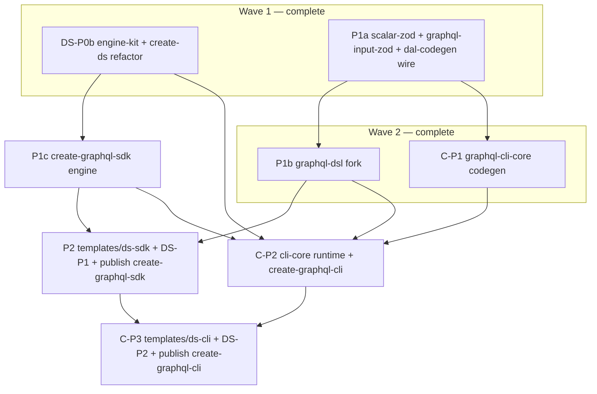

# Generator family — implementation roadmap

Living execution plan for the SDK, CLI, and DS-generator designs ([13](13-graphql-sdk-generator.md), [14](14-graphql-cli-generator.md), [15](15-create-ds-generator-integration.md)). **B0, Wave 1, and Wave 2 are complete** on `main` (`403b77f`).

**Status:** **Wave 3 in progress** — C-P2 `graphql-cli-core` `runCli` + `create-graphql-cli` on `engine-kit` (monorepo; pending merge PR). P1c `create-graphql-sdk` still open. Wave 2 shipped P1b `graphql-dsl` ([#43](https://github.com/CorpDK/coding-templates/pull/43)) and C-P1 `graphql-cli-core` codegen ([#42](https://github.com/CorpDK/coding-templates/pull/42)). Lockstep npm **`2026.10.0-alpha.17`** until the next CalVer bump after Wave 3 lands.

---

## Achieved (through Wave 1 + publish train)

| Milestone                                       | Evidence                                                                                                              |
| ----------------------------------------------- | --------------------------------------------------------------------------------------------------------------------- |
| Cross-design docs at rev 13 / 6 / 6             | `docs/developer/13–15` on `main`                                                                                      |
| Seven npm placeholders + lockstep CalVer        | Workspace packages; `PUBLISH_ORDER` in [04-npm-publish-ds-automation.md](../admin/04-npm-publish-ds-automation.md)    |
| Manual B0 bootstrap + GitHub trusted publishing | `scripts/npm-b0-bootstrap.sh`, admin doc § Generator B0                                                               |
| **Wave 1 implementation**                       | `scalar-zod`, `graphql-input-zod`, `dal-codegen` wiring (P1a); `engine-kit` + `create-ds` refactor (DS-P0b)           |
| **Monorepo CI**                                 | Orchestrated Monorepo quality (12 lockstep packages + `quality-templates`), Sonar, publish dispatch on the same SHA   |
| **Lockstep npm `latest`**                       | All twelve `@corpdk/*` DS automation packages at **`2026.10.0-alpha.17`** with provenance (after Wave 2 CalVer bump) |
| Typed scaffolds for remaining phases            | **`create-graphql-cli`** + cli-core **runtime** (C-P2) implemented; **`create-graphql-sdk`** stub until P1c; **`graphql-dsl`** and **`graphql-cli-core`** codegen implemented |
| **Wave 2** (`graphql-dsl`, `graphql-cli-core`)  | P1b runtime + codegen; C-P1 relation-ids emitter, man/texi, DAL golden tests ([#42](https://github.com/CorpDK/coding-templates/pull/42), [#43](https://github.com/CorpDK/coding-templates/pull/43)) |

**Still legacy until later phases:** `templates/ds-sdk` (`client-preset`), `templates/ds-cli` (`@corpdk/codegen-cli` preset). **`create-ds` uses `@corpdk/engine-kit`** after DS-P0b (#36).

---

## Phase dependency graph

Canonical **publish order** remains [doc 15 §4.3](15-create-ds-generator-integration.md#43-dependencies-and-publishing-canonical-publish-order).

---

## Waves and deliverables

### Wave 1 (complete) — parallel tracks

| Track | Phase       | Packages                                                     | Primary registers / gates                                                                            |
| ----- | ----------- | ------------------------------------------------------------ | ---------------------------------------------------------------------------------------------------- |
| A     | **DS-P0b**  | `engine-kit`, `create-ds`                                    | R-D10, R-D11, R-D13–R-D15; [§11.3–§11.5](15-create-ds-generator-integration.md#113-corpdkengine-kit) |
| B     | **SDK P1a** | `scalar-zod`, `graphql-input-zod`, `dal-codegen`, `dal-core` | R-09, R-10, R-35, R-37; R-D07; [SDK §13 P1a](13-graphql-sdk-generator.md#13-implementation-phases)   |

**No cross-track merge dependency** until Wave 3 (P1c needs DS-P0b).

### Wave 2 (complete) — merged #42 / #43

| Phase    | Depends on | Notes                                                                                                                           |
| -------- | ---------- | ------------------------------------------------------------------------------------------------------------------------------- |
| **P1b**  | P1a        | Single PR per design (DSL coupling); fork `genql` @ `15f27b9`, L1 `FieldsSelection`, aliases/directives/`define*`, §3.8 helpers |
| **C-P1** | P1a        | `graphql-cli-core` codegen port from `codegen-cli`; R-C01, R-C02, R-C17                                                         |

### Wave 3 — engines

| Phase    | Gates                                      | Monorepo status (2026-11-23)                                                                 |
| -------- | ------------------------------------------ | ------------------------------------------------------------------------------------------ |
| **P1c**  | DS-P0b + P1a (+ P1b for realistic codegen) | Open                                                                                       |
| **C-P2** | DS-P0b, P1a, P1b, P1c, C-P1                | Implemented (fixture SDK + `engine-kit` engine; P1c still required for real SDK `generate`) |

### Wave 4 — integration releases (coordinate, do not split)

| Release train     | Phases bundled                                                                                                           |
| ----------------- | ------------------------------------------------------------------------------------------------------------------------ |
| SDK + DS SDK path | **P2** + **DS-P1** (drop `client-preset`, private `templates/ds-sdk`, `--with-sdk`, publish `create-graphql-sdk`)        |
| CLI + DS CLI path | **C-P3** + **DS-P2** (drop `codegen-cli` preset, private `templates/ds-cli`, `--with-cli`, publish `create-graphql-cli`) |

### Later

- **SDK P5** — UI templates adopt new SDK.
- **C-P4** — `npm deprecate @corpdk/codegen-cli`.
- **R-33** — optional server `input-zod` via shared runtime (post–P1a).

---

## Parallelism rules

| Safe in parallel                      | Must stay sequential              |
| ------------------------------------- | --------------------------------- |
| DS-P0b ∥ P1a (Wave 1)                 | P1b after P1a                     |
| P1b ∥ C-P1 (Wave 2)                   | P1c after DS-P0b                  |
| Per-package unit tests inside each PR | P2 + DS-P1 one PR / one release   |
|                                       | C-P3 + DS-P2 one PR / one release |
|                                       | P1b not split across PRs (design) |

---

## Wave 1 acceptance (merged)

### DS-P0b — merged ([#36](https://github.com/CorpDK/coding-templates/pull/36), `8c7f13e`)

- [x] `@corpdk/engine-kit` implements §11.3 modules with tests (23 vitest).
- [x] `create-ds` refactor: §11.5 exit codes, strict flags, `tsc` build, `runInit`/`runUpgrade` exports.
- [x] Fixture/comparison tests (gate-added; R-D11 intent).
- [x] Publish-order guard + canonical drift in publish pipeline / `check-ds-publish-order`.
- [x] `syncCanonical` / `checkCanonical`; demo schema + seed in canonical; `.gitignore` aligned (R-D13–R-D15).
- [x] Docs synced via no-mistakes.

### SDK P1a — merged ([#35](https://github.com/CorpDK/coding-templates/pull/35), `393c093`)

- [x] `@corpdk/scalar-zod` extracted; `dal-core` re-exports unchanged surface (R-37).
- [x] `@corpdk/graphql-input-zod` runtime + `./codegen` emitter; **byte-identical** `dal-codegen` `input-zod.ts` for DAL schema (R-10, R-35).
- [ ] L3 `z.ZodType<Types.X>` type tests where applicable (R-09) — deferred to P1b/P2 where needed.
- [x] Fixed-order builds: Monorepo CI, Sonar, DS + canonical Dockerfiles build `graphql-input-zod` first (R-D07, SDK §9.3).
- [x] `pnpm --filter @corpdk/dal-core test` / `dal-codegen` tests green.

---

## Shipped merges (Wave 1 + CI / publish train)

| PR                                                        | Topic                                                                | Merge SHA  |
| --------------------------------------------------------- | -------------------------------------------------------------------- | ---------- |
| [#37](https://github.com/CorpDK/coding-templates/pull/37) | Monorepo CI / quality matrix foundations                             | `a1300243` |
| [#35](https://github.com/CorpDK/coding-templates/pull/35) | SDK **P1a** (`scalar-zod`, `graphql-input-zod`, `dal-codegen` wire)  | `393c093`  |
| [#36](https://github.com/CorpDK/coding-templates/pull/36) | **DS-P0b** (`engine-kit`, `create-ds` refactor)                      | `8c7f13e`  |
| [#38](https://github.com/CorpDK/coding-templates/pull/38) | Lockstep 12-package quality matrix, CalVer gate, `quality-templates` | `084931a`  |
| [#39](https://github.com/CorpDK/coding-templates/pull/39) | Publish via `gh workflow run` + `checkout_sha` (npm OIDC fix)        | `bdb5a0d`  |
| [#40](https://github.com/CorpDK/coding-templates/pull/40) | Lockstep **2026.10.0-alpha.16** bump + live publish                  | `2a00576`  |
| [#42](https://github.com/CorpDK/coding-templates/pull/42) | C-P1 **`graphql-cli-core`** codegen                                  | `9e7d1c2`  |
| [#43](https://github.com/CorpDK/coding-templates/pull/43) | P1b **`graphql-dsl`** runtime + codegen                              | `403b77f`  |

**Ship policy:** run **`no-mistakes axi run`** with intent text for the phase when a branch is ready; **no-mistakes** owns push and PR creation (do not run `gh pr create` from implementation threads unless explicitly requested).

---

## References

- Registers: SDK [§17](13-graphql-sdk-generator.md#17-remaining-work-register), CLI [§16](14-graphql-cli-generator.md#16-remaining-work-register), DS [§12](15-create-ds-generator-integration.md#12-remaining-work-register)
- Coding standards: [08-coding-guidelines.md](08-coding-guidelines.md)
- Publish: [04-npm-publish-ds-automation.md](../admin/04-npm-publish-ds-automation.md)

**Last updated:** 2026-11-23
