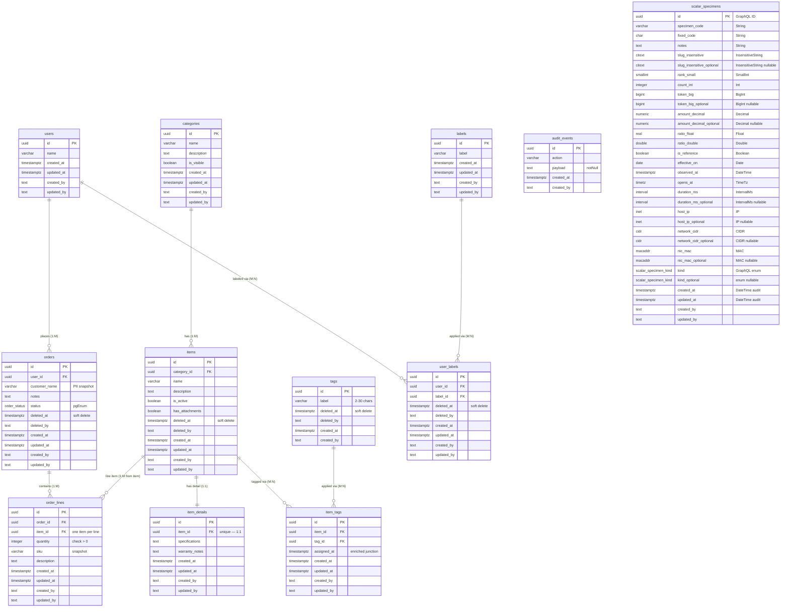

# Sample Commerce Schema — Entity Relationship Diagram

Co-located with `schema/` (one level up — Drizzle Kit imports all files under the schema path and cannot load `.md`).

Reference ER for `@corpdk/ds`: a small catalog-and-checkout domain wired end-to-end for DAL codegen, plus standalone tables that exercise audit profiles, delete strategies, and junction patterns.

## Domain story

- **Catalog**: `categories` group `items`; each `item` has optional `item_details` (1:1). `tags` classify items through enriched junction `item_tags` (M:N).
- **Checkout**: `users` are customers. Each user places many `orders` (1:M). Each order has many `order_lines` (1:M); **each line references exactly one `item`** via `item_id` (with `quantity` for units).
- **Segmentation**: `labels` tag users through pure junction `user_labels` (M:N, soft-deletable links) — distinct from item `tags`.
- **Supporting (no FK into core ER)**: `audit_events` append-only log; `scalar_specimens` exercises every DAL-supported PG → GraphQL scalar (requires `citext` extension).
- **Phase 5 constraints (commerce)**: `tags.label` (2–30 chars) and `order_lines.quantity` (must be &gt; 0).

## Entity profiles

| Entity | Audit | Delete | Relation pattern |
| ------ | ----- | ------ | ---------------- |
| **users** | full | hard | 1:M → orders; M:N → labels via userLabels |
| **categories** | full | hard | 1:M parent of items |
| **items** | full | soft | M:1 → categories; 1:1 → itemDetails; M:N → tags via itemTags; 1:M ← orderLines |
| **itemDetails** | full | hard | 1:1 dependent of items (`itemId` unique FK) |
| **tags** | append-only | soft | M:N → items via itemTags; `label` 2–30 chars |
| **itemTags** | full | hard | Enriched M:N junction (`assignedAt` + unique item+tag pair) |
| **orders** | full | soft | M:1 → users; 1:M parent of orderLines; PII `customerName` snapshot |
| **orderLines** | full | hard | M:1 → orders; M:1 → items (one catalog item per line); `quantity` check &gt; 0 |
| **labels** | full | hard | M:N → users via userLabels (distinct from item `tags`) |
| **userLabels** | full | soft | Pure M:N junction (FKs + audit only); unique user+label pair |
| **auditEvents** | append-only | hard | Standalone — no FK relations; `payload` required |
| **scalarSpecimens** | full | hard | Standalone — no FK; seed rows cover all PG → GraphQL scalars plus nullable optional columns for `isNull` filters |

## PG → GraphQL scalar legend (`scalar_specimens`)

Reference table for DAL codegen and GraphQL Yoga wire types. Audit columns on all entities reuse `timestamptz` → **`DateTime`** and actor `text` → **`String`** (not duplicated on every business column below).

| Column (physical) | PostgreSQL | GraphQL scalar |
| ----------------- | ---------- | -------------- |
| `id` | `uuid` | **`ID`** (built-in) |
| `specimen_code` | `varchar` | **`String`** |
| `fixed_code` | `char(8)` | **`String`** |
| `notes` | `text` | **`String`** |
| `slug_insensitive` | `citext` | **`InsensitiveString`** |
| `slug_insensitive_optional` | `citext` (nullable) | **`InsensitiveString`** + **`InsensitiveStringFilter.isNull`** |
| `rank_small` | `smallint` | **`SmallInt`** |
| `count_int` | `integer` | **`Int`** |
| `token_big` | `bigint` | **`BigInt`** |
| `token_big_optional` | `bigint` (nullable) | **`BigInt`** + **`BigIntFilter.isNull`** |
| `amount_decimal` | `numeric(14,4)` | **`Decimal`** |
| `amount_decimal_optional` | `numeric` (nullable) | **`Decimal`** + **`DecimalFilter.isNull`** |
| `ratio_float` | `real` | **`Float`** |
| `ratio_double` | `double precision` | **`Double`** |
| `is_reference` | `boolean` | **`Boolean`** |
| `effective_on` | `date` | **`Date`** |
| `observed_at` | `timestamptz` | **`DateTime`** |
| `opens_at` | `timetz` | **`TimeTz`** |
| `duration_ms` | `interval` | **`IntervalMs`** |
| `duration_ms_optional` | `interval` (nullable) | **`IntervalMs`** + **`IntervalMsFilter.isNull`** |
| `host_ip` | `inet` | **`IP`** |
| `host_ip_optional` | `inet` (nullable) | **`IP`** + **`IPFilter.isNull`** |
| `network_cidr` | `cidr` | **`CIDR`** |
| `network_cidr_optional` | `cidr` (nullable) | **`CIDR`** + **`CIDRFilter.isNull`** |
| `nic_mac` | `macaddr` | **`MAC`** |
| `nic_mac_optional` | `macaddr` (nullable) | **`MAC`** + **`MACFilter.isNull`** |
| `kind` | `scalar_specimen_kind` (`pgEnum`) | **`ScalarSpecimenKind`** (enum) |
| `kind_optional` | `scalar_specimen_kind` (nullable) | **`ScalarSpecimenKindFilter.isNull`** |

## Migrations / local test

- Apply Drizzle migrations through **`0003_last_black_tarantula`** so nullable optional columns exist on `scalar_specimens`.
- Seed rows **`scalar-reference-v1`** (populated optionals) and **`scalar-nulls-v1`** (NULL optionals) cover filter edge cases (`isNull`, citext/network filters, etc.) — run `pnpm db:seed` (or your package’s seed script) after migrate.
- If the database already had these columns from manual schema work, **`0003`** is catch-up only; confirm state before applying on shared or production databases.

## Notes

- **GraphQL output (Phase 2)**: entity types expose **navigation fields** from Drizzle `relations()` — FK scalars (`categoryId`, `userId`, `itemId`, etc.) are omitted from output types but remain on create/update inputs. Internal repository records still carry FK values for DataLoader batch keys.
- **Checkout path**: `users` → `orders` → `order_lines` → `items` → `categories` is the primary read/navigation chain for order fulfillment demos.
- **1:1 (`items` ↔ `itemDetails`)**: FK on dependent `item_details.item_id` with unique index; optional extended specs separate from core item row.
- **Order lines ↔ items**: each line row associates with **one** catalog item (`item_id`); `quantity` counts units; `sku` / `description` are snapshots at order time.
- **Enriched junction (`itemTags`)**: M:N link table with business column `assignedAt` beyond the two FKs — not a pure link table.
- **Pure junction (`userLabels`)**: M:N link for navigation validation — FKs and audit columns only (contrast with `itemTags`); soft-deletable links without touching `users` / `labels`.
- **Append-only**: `tags` and `auditEvents` have `createdAt` + `createdBy` only — no `updatedAt` / `updatedBy`; `auditEvents.payload` is required (`notNull`).
- **Soft delete**: `deletedAt` (+ optional `deletedBy`) on `items`, `tags`, `orders`, and junction `userLabels`.
- **Scalar showcase**: `scalar_specimens` is intentionally outside the commerce ER — use **`scalar-reference-v1`** (populated optionals) and **`scalar-nulls-v1`** (NULL optionals) to regression-test filters (`isNull`, citext eq/like without `isCaseInsensitive`, network `eq`/`neq`), sorts, aggregates, and custom scalar parse/serialize (enable `CREATE EXTENSION IF NOT EXISTS citext` before migrate/seed).
